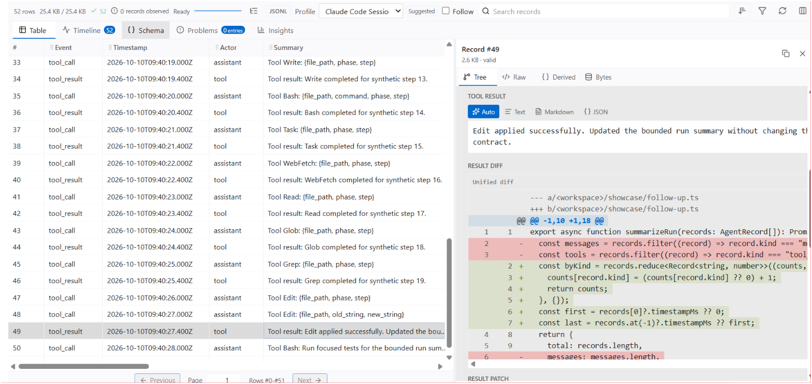
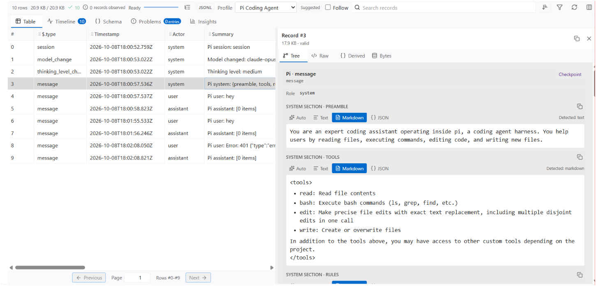
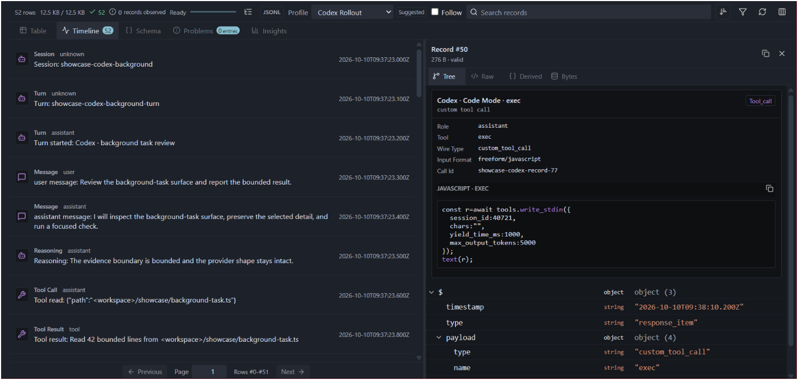
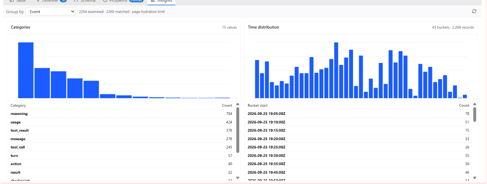
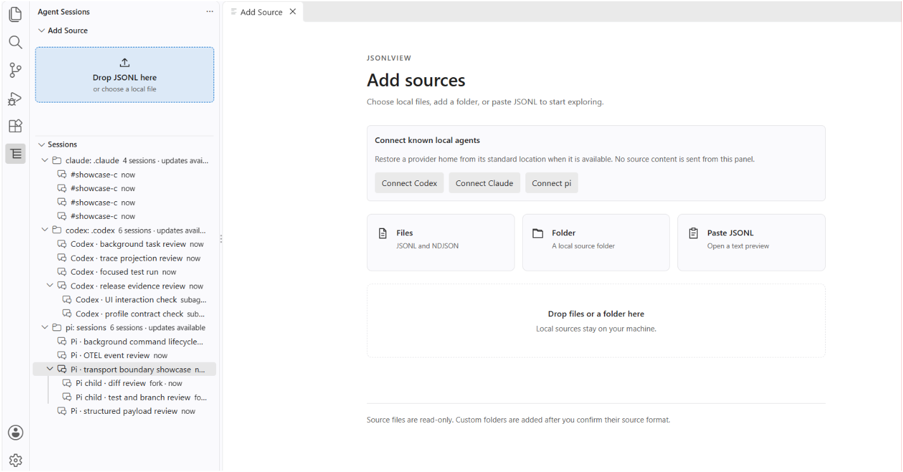
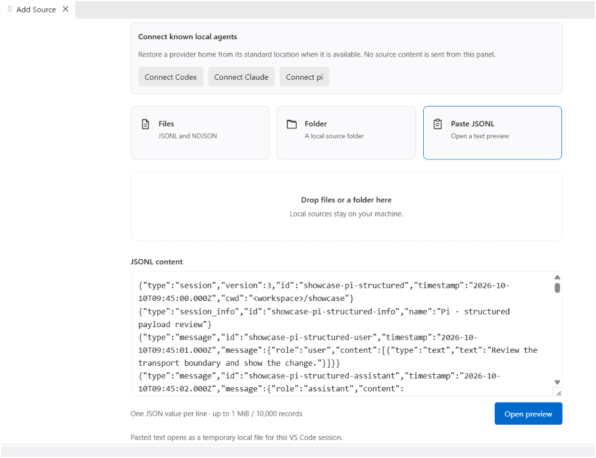

# JsonlView

**A read-only event data studio for VS Code.**

JsonlView turns large JSONL and NDJSON files into a workbench for logs,
telemetry, traces, coding-agent runs, and local agent session history. Browse
physical records quickly, understand their meaning, and inspect the exact source
without changing the file.

## Why JsonlView

JSONL is easy for programs to append and difficult for people to inspect. A
single file can contain thousands of records, malformed lines, tool calls,
trace events, and long agent messages. JsonlView keeps the physical record
authoritative while adding bounded indexing, semantic views, and deliberate
detail loading.

## See It

The same workbench adapts to different event shapes while keeping the source
record available in Raw.

The screenshots use public-shaped, redacted fixtures prepared in the companion
harness; they contain no private transcript bodies or machine paths.

### Diff and prompt detail





### Agent profile timelines



### Event analysis



## What You Get

- **Fast bounded browsing:** byte-aware indexing, virtualized pages, lazy detail
  hydration, and BigInt-safe ordinals for large files.
- **Views for different questions:** Table, Timeline, Schema, Problems,
  Insights, Tree, Raw, Derived, and Bytes.
- **Page-local record lineage:** inspect supported relationships in the current
  filtered and sorted result page from the selected record. It uses the accepted
  page without another source scan, page request, or IPC; relationships outside
  that page are unobserved and remain explicitly uncovered. The legacy Graph
  Host protocol is dormant in the Webview and retains its existing safeguards.
- **Useful semantics:** automatic profiles for Codex, Claude Code, pi coding
  agent, OpenTelemetry, structured application logs, software-engineering
  trajectories, and generic JSONL fallback.
- **Provider-aware details:** tool results, diff and patch payloads, thinking,
  checkpoints, and nested system prompt sections remain inspectable in the
  shared Tree, Raw, Markdown, and JSON detail surfaces.
- **Safe inspection:** malformed records remain visible, unknown events fall
  back to generic JSON, and the exact source stays available for copying.
- **Focused analysis:** typed filters, text search, physical paging, row-order
  control, bounded category/time Insights, and an opt-in tail Follow mode.
- **Agent session navigation:** an optional read-only tree for supported local
  Codex, Claude, and pi session homes, with parent/child relationships and
  incremental loading.

### Session Navigator (opt-in)

Enable `jsonlView.sessionNavigator.enabled` only when you want a local,
metadata-bounded view of supported agent session homes. It starts disabled,
asks for explicit source authorization, and keeps transcript bodies in their
provider files.



### Source entry



To save a separate raw copy, open the source in JsonlView and run
**JsonlView: Export Entire Raw JSONL Source…** from the Command Palette,
editor title, or upper source board. It copies every physical byte, including
malformed rows, up to 1 GiB; table filters and sort do not change the export.
Choose a new destination: existing files are never replaced. Cancel before
publication to stop the copy. Destinations must support filesystem hard links;
some removable drives and network shares may reject the operation.

For a smaller scope, run **JsonlView: Export Selected / Range / Matching Raw
Records…** from the same surfaces. Choose the selected detail record, a 0-based
inclusive physical ordinal range, or all matches of the last successfully
delivered query. Matching exports scan the source rather than exporting only
the visible page; table sort does not change ascending physical output order.
Every included record retains its original bytes and delimiter, including CRLF
and invalid UTF-8. With an active predicate, blank or invalid JSON/UTF-8 records
do not match, consistent with table queries. This is a raw full-record copy,
not a projected-column format.

The scoped operation permits at most 256 MiB of source scanning, one million
examined records, 64 MiB of output and a 30-second cooperative precommit
deadline. Predicate inspection permits records up to 1 MiB. Exhausting a limit
fails before publication; no partial result is presented as complete. Changing
the accepted selection, predicate, source or profile while the save picker or
copy is active revokes that captured intent.

Use **JsonlView: Inspect or Retry Raw Export…** on the upper source board or
Command Palette after an interrupted result. The retained operation ID and
selection digest stay unchanged. Inspection proves the destination by file
identity and SHA-256; an unknown or unrelated target is preserved. Explicit
retry requires a current open-document grant and the same observed physical
source version and profile, including after reopening VS Code. A previously
committed output that was later moved or deleted is never automatically
recreated. Journals and pending raw spools live in extension-owned local global
storage; pending/corrupt state is retained, with caps of 256 operations and eight
scan attempts per operation. Full storage refuses new operations; it does not
evict recovery evidence. See [ADR-072](docs/decisions/072-scoped-raw-export-recovery.md)
for lifecycle, platform limits and rollback.

## Install

Choose one registry build for the VS Code installation.

| Registry | Extension identity |
| --- | --- |
| [Open VSX](https://open-vsx.org/extension/Sumi-Sophia/jsonl-view) | Sumi-Sophia.jsonl-view |
| [Visual Studio Marketplace](https://marketplace.visualstudio.com/items?itemName=Sumi-Sophia.jsonlview-data-studio) | Sumi-Sophia.jsonlview-data-studio |

You can also open the VS Code Extensions view and search for **JsonlView Data
Studio**. The extension requires VS Code 1.136 or newer and file-backed
random access; virtual workspaces are not supported in this release.

## A Real Use Path

1. Open a .jsonl or .ndjson file in VS Code. Use **Open With** when another
   editor is registered for the file type.
2. Start in **Table** to scan records. Switch to **Timeline**, **Schema**, or
   **Problems** when the shape or data quality needs a different view.
3. Select a record to open the detail drawer. Use **Lineage** for supported
   relationships within the current result page, **Tree** for structure,
   **Raw** for the exact source, **Derived** for bounded semantic fields, and
   **Bytes** for physical offsets.
4. Apply a profile when the automatic suggestion needs confirmation. Profiles
   add labels and fields; they do not rewrite the JSONL record.
5. Enable **Follow** when a producer appends to the file. Use **Insights** only
   when you need bounded aggregate counts or time buckets.
6. Enable **Session Navigator** in settings when you want local agent sessions.
   Standard Codex, Claude, and pi homes can be detected after opt-in; other
   roots can be added explicitly from the Navigator.

## Opt-In Product Lines

The editor is read-only by default. The following surfaces are deliberately
opt-in or disabled by default:

| Surface | Default | What it does |
| --- | --- | --- |
| Profile auto-detection | On | Suggests a semantic view from bounded samples. |
| Follow | Off | Tracks an append-only tail after an explicit action. |
| Insights | On demand | Runs a bounded aggregate scan only when opened or refreshed. |
| Session Navigator | Off | Reads supported local agent metadata after authorization. |
| Native newline scanner | Off | Probes the optional accelerator only when configured. |
| MCP navigation contract | Disabled | Keeps the experimental metadata adapter out of runtime transports. |
| Read-only MCP stdio | Explicit launch | Serves one source granted by the launching client; activation never starts it. |
| ACP diagnostic delivery | Explicit action | Starts a configured local ACP adapter in a trusted workspace. |
| OTLP export | Disabled | Keeps observability export out of the product until separately enabled. |

## Privacy And Source Authority

- JsonlView never edits the source file, executes its contents, or requires a
  network connection to browse it.
- Indexes, session catalog rows, and Webview projections are disposable
  metadata. The source JSONL remains the authority.
- Record hydration is bounded. Raw and Copy preserve the available source
  value when a structured view is incomplete or ambiguous.
- Session Navigator reads local provider metadata only after opt-in and keeps
  transcript bodies out of its catalog.
- The metadata-only MCP navigation contract and OTLP export remain disabled.
  The opt-in query MCP server uses stdio; the default product path creates no
  network listener.

## External Read-Only MCP

The extension package includes `dist/mcp-server.cjs`. An external MCP client can
launch it with Node 22.12 or newer (the product pins Node 24.15.0). Resolve
`<extension-root>` to the extracted package or the exact installed extension
directory. No npm binary installation is required. A client configuration is:

```json
{
  "mcpServers": {
    "jsonlview": {
      "command": "<absolute-path-to-node>",
      "args": ["<extension-root>/dist/mcp-server.cjs"],
      "env": {
        "JSONLVIEW_EXTENSION_PATH": "<extension-root>",
        "JSONLVIEW_MCP_SOURCE_ID": "acceptance-source",
        "JSONLVIEW_MCP_SOURCE_PATH": "<absolute-path-to-authorized-source.jsonl>"
      }
    }
  }
}
```

This is the native Claude-style configuration shape; use the client's native
MCP table for Codex. `SOURCE_ID` and `SOURCE_PATH` are required. The extension
root defaults to the parent of the server's `dist` directory. Launching grants
this process access to exactly the configured source; tool inputs cannot choose
another filesystem path. This grant is separate from VS Code authorization and
ends when the client stops the process. A configured root is not a directory
listing grant. Use only a file you explicitly intend to expose to that client.

The server identifies as `JsonlView` version `0.1.0`. It accepts MCP
`2026-07-28`, `2025-11-25` and `2025-06-18`. Legacy clients use `initialize`
followed by `notifications/initialized`; modern requests supply the per-request
protocol-version/client-capabilities metadata and may use `server/discover`.
It advertises `tools` and `resources` capabilities:

| Surface | Contract |
| --- | --- |
| `jsonlview_query_records` | Bounded raw physical records; ordinal and byte offsets are decimal strings. Maximum 256 rows and 512 KiB per query. |
| `jsonlview_query_trajectory_slice` | Bounded semantic matches for `actor` and/or `hasError`, explicit unknown values, partial cursors and fixed errors. Maximum 128 matches; see [ADR-066](docs/decisions/066-bounded-trajectory-query-contract.md). |
| `jsonlview://source/{sourceId}/spine` | Resource template for an initial bounded trajectory spine with omission counts; encode the source ID as one URI segment. |

`resources/list` is empty because sources are addressed through the template;
`resources/templates/list` exposes it. These query surfaces are read-only.
There is no HTTP service, background daemon, write tool or implicit source
discovery. The packaged physical query uses the cancellable portable reader;
the optional native accelerator is not required.

The default server budget is 3000 ms from admission through queueing and work,
with two active and eight queued requests. `JSONLVIEW_MCP_BUDGET_MS` accepts
1–60000 and `JSONLVIEW_MCP_MAX_CONCURRENCY` accepts 1–8. Semantic query deadlines
are also capped by their own request budget. The transport rejects input lines
over 1 MiB, bounds responses to 4 MiB and bounds tool arguments to 32 KiB. Reads
and cancellation are cooperative; an active filesystem operation cannot be
preempted. Snapshots observe metadata and do not promise immutable file content.

For a small physical query, call `jsonlview_query_records` with
`{"sourceId":"acceptance-source","startOrdinal":"0","limit":2,"maxBytes":4096}`.
Successful configuration or tool listing alone does not prove external-client
interoperability: verify a real bounded tool call against a synthetic file and
record the loaded package revision. [ADR-052](docs/decisions/052-rust-query-mcp-acp-boundary.md)
defines the protocol/process boundary and rollback.

ACP diagnostics use **JsonlView: Send Last Diagnostic via ACP** with
`jsonlView.acp.command` and optional arguments in a trusted workspace. The
adapter uses the provider's existing login state and receives the active JSONL
as an explicitly configured read-only MCP server. Tool permission requests offer
once-only choices; closing or cancelling the operation closes its owned ACP
session. UTF-8 transcript chunks retain their characters and session identity.
The notification and status bar show startup, handshake, session creation,
response and permission stages with elapsed time. The status entry opens
JsonlView Output. Failures identify the stage, timeout or safe error code;
adapter stderr and RPC error bodies stay private. A response timeout can happen
after submission, so the extension never automatically resends the diagnostic.
The MCP server stops and cancels pending reads when its client closes the input
stream or response delivery fails. See [ADR-079](docs/decisions/079-acp-mcp-stream-lifecycle.md).

See [format and profile boundaries](docs/format-and-profile-boundaries.md) for
the exact contract and unsupported formats.

## Supported Boundary

The current physical adapter accepts file-backed .jsonl and .ndjson. It
does not claim regular JSON arrays/objects, multiline text logs, compressed
JSONL, OTLP protobuf, or Chrome/Jaeger trace JSON as drop-in formats. Those
formats need their own framing and authority rules; see the
[format boundary](docs/format-and-profile-boundaries.md).

Semantic profiles are additive. They can identify common Codex, Claude Code,
pi, OpenTelemetry, application-log, and Agent fields, but unknown records stay
available through the generic view. The observed Claude and agent surface
rules are compatibility behavior, not a promise that a producer's private
schema is stable.

## Roadmap Preview

The next architecture work is staged and evidence-led:

- [Runtime-bounded decomposition and toolchain ownership](docs/decisions/035-architecture-decomposition-and-toolchain-ownership.md)
  keeps the extension host, Webview, engine, profiles, and native scanner under
  explicit ownership while preserving the current facade.
- [Architecture evolution slices](docs/decisions/039-architecture-evolution-slices.md)
  proposes barrel export isolation, test colocation, and staged vertical
  migration as small reversible steps.
- [Acceleration roadmap](docs/acceleration-roadmap.md) measures optional native
  scanning and future query work against the portable implementation before
  any capability becomes a default.

These are roadmap decisions and experiments, not promises to mutate source
files, add a network service, or split the product into packages before a
second consumer and release contract justify it.

## Documentation

- [Product documentation map](docs/README.md)
- [Format and profile boundaries](docs/format-and-profile-boundaries.md)
- [Decision records](docs/decisions/README.md)
- [Reliability service levels](docs/reliability/service-levels.md)
- [Security threat model](docs/security/threat-model.md)
- [Release and publication notes](docs/marketplace-publishing.md)
- [Changelog](CHANGELOG.md)

## Development

The repository uses the Node version declared by .node-version and the pnpm
version declared by package.json.

    pnpm install --frozen-lockfile
    pnpm check:contract
    pnpm check:typescript-erasable
    pnpm check:typescript-gates
    pnpm check:typescript-tests
    pnpm typecheck
    pnpm test
    pnpm build

## License

JsonlView is available under the [MIT License](LICENSE.txt). Third-party
licenses and notices are listed in [THIRD-PARTY-NOTICES.txt](THIRD-PARTY-NOTICES.txt).
