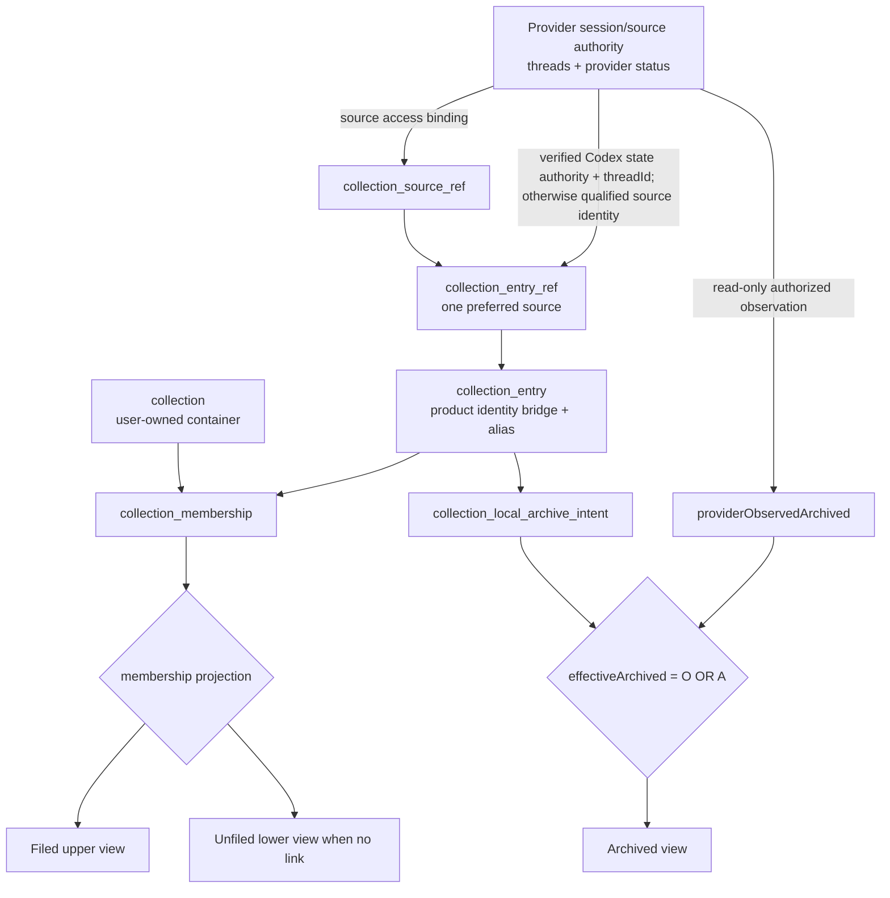
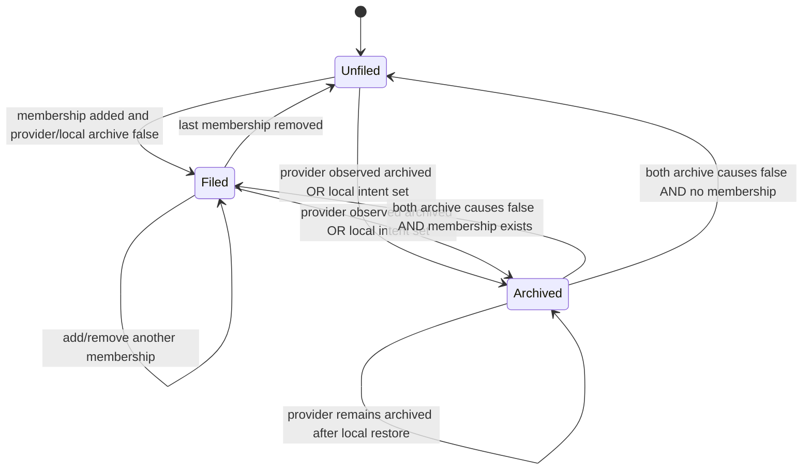
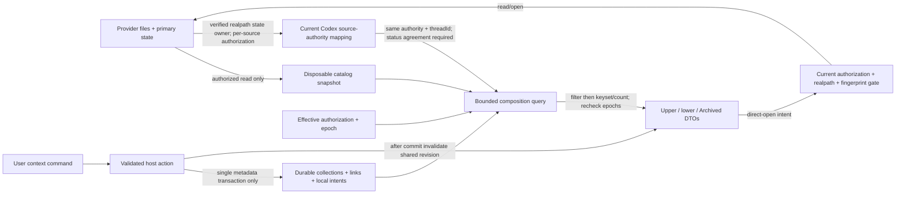
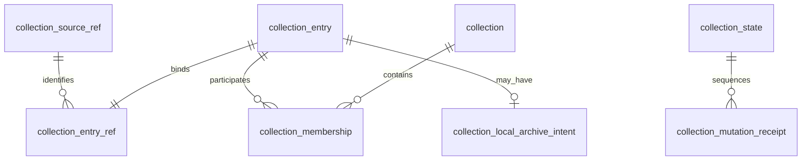

# Navigator collections: metadata and application contract

Status: **proposed**. This document designs a product-owned metadata aggregate
and its application commands. It does not accept a visual variant, implement
runtime behavior, execute a migration, or resume other query/UI work.

## Scope, evidence, and choices

Goal: let a user organize existing sessions and their own sources into
collections, recover that organization after restart, and keep source data
read-only. Existing provider sessions remain the authoritative entities. The
new durable rows are qualified identity references and user associations; they
do not copy session/source content or replace the provider catalog. The upper
`jsonlView.sourceDrop` surface contains two areas: the existing
paste/drop/local-file/local-folder/agent-connect intake, and the new
collections/added-items/history area. The lower
`jsonlView.sessionNavigator` remains the existing native Sessions tree.
Collection and local-archive operations initiated from a row change only our
metadata.

| Requirement | Proposed contract |
| --- | --- |
| R1: preserve intake and lower Sessions | Retain every current intake action, native source hierarchy, authorization route, bounded continuation, and direct session/file open. |
| R2: user-owned organization | Create, rename, list, and delete collections; link or unlink session, file, and source references. Local session archive intent is separate from collection membership and provider-native archive status. Never mutate the referenced source, provider row, or transcript. |
| R3: mutually exclusive session projection | For an authorized/current session, provider-native archived status OR our local archive intent places it in **Archived**; otherwise any collection membership places it in upper **Collections**; otherwise it appears in lower **Unfiled**. Archive takes display precedence while preserving every membership. Removing local archive intent cannot undo provider-native archive. |
| R4: durable references | Collections, aliases, item identities, and memberships outlive catalog replacement, rebuild, revocation, and restart. Metadata persistence does not preserve source content. |
| R5: independent analysis selection | If an analysis selector is presented, selection changes current analysis input only. This proposal does not add a permanent checkbox UI or make selection file, unlink, rename, or authorize a source. |
| R6: bounded secure views | Filter authorization and filing before pagination; use stable ordering and revision-bound cursors. No saved metadata grants source access or exposes unauthorized paths/content. |

This is a C2 shared persistence/concurrency **proposal**. The product application
owner defines commands and identities; TypeScript Navigator infrastructure owns
storage and resolution; the existing extension host owns authorization and open
effects; upper/native adapters own presentation. No new service, HTTP API,
query engine, package, Rust database, or provider database write is proposed.

Source inspection is pinned to product revision
`14f7bfcd75edf25232c932da0dddf58a3682896f`. Existing facts are:

- `src/application/catalog/catalog-port.ts` owns `CatalogPort` and
  `SessionCatalogPort`, including `getChildrenPage`; `catalog-identity.ts`
  qualifies a provider native ID with a source ID derived from canonical root
  and state-root URIs. Generation/fingerprint describe currentness, not identity.
- `src/infrastructure/navigator/catalog-store.ts` opens `node:sqlite` and owns
  catalog schema 3. Its `syncSources` and `reconcileSourceMetadata` delete
  revoked source rows; source/entity/registry foreign-key cascades therefore
  cannot own a user's collections or aliases.
- `src/experimental/session-navigator/tree-provider.ts` owns native commands,
  bounded page guards, and the current open chain. `source-intake.ts` owns the
  upper intake decoder/dispatcher. Neither currently implements collections.
- Pasted preview content is session-lived. Only explicit Save As and source
  registration can establish a durable file/source; a metadata link alone
  cannot make a preview recoverable after restart.
- The current Codex native provider reads authorized `threads` rows regardless
  of the row's archived bit, maps that native status separately from the stable
  thread ID, and normalizes active/archive directory locations to the same
  provider root. The observed status comes from provider state, not the path.
  Partial/truncated scans do not establish that a native archive state changed.

Read-only Codex source inspection is separately pinned to
`708e3e2c70142c75682a375669ca60754f76976d`. Its archive/unarchive commands move
rollout directories and update provider state; archive may also affect
descendants. Those side effects belong to Codex. JsonlView v1 observes the
provider status on authorized catalog refresh and does **not** invoke those
commands, infer status from a path, or model a local archive request as a
provider archive. The provider-native state is not copied into durable
collection metadata and is not cleared by a local restore/reset.

Official Google material, checked 2026-10-31, supports adding an existing
Gemini chat to a notebook and describes moving past chats and cross-product
notebook integration. It also documents deletion of attached chats/sources
when deleting a notebook. These are reference observations, not JsonlView
contracts. This proposal deliberately defines source-preserving deletion.
Official material did **not** establish single/multiple notebook membership,
whether adding hides a chat from the total/recent list, or remove-only return
behavior. The following behaviors are proposed product choices.
[Gemini notebook help](https://support.google.com/gemini/answer/16972047?hl=en&co=GENIE.Platform%3DDesktop),
[Google integration announcement](https://blog.google/innovation-and-ai/products/gemini-app/notebooks-gemini-notebooklm).

V1 proposes **many-to-many membership**, rather than assuming exclusive
ownership. This policy remains proposed pending product review. A dedicated Move action
removes one named link and adds another atomically; Add to collection leaves
other links intact. Duplicate names are allowed because UUIDs own identity.
Names and aliases are user-authored display metadata, never filesystem names.
An item has one default display state with this precedence: effective archive,
then one-or-more collection memberships, then unfiled. This is a projection
derived from provider status plus owned links/intents, not a copied session
record or a mutable `filed`/`archived` boolean on the provider entity.
The alternative of a single `collection_id` on a catalog entity cannot preserve
multiple links or survive disposable entity replacement. A persisted `filed`
boolean is rejected because it can disagree with membership.

The review order for a future implementation is deliberately contract-first:
the SQL tables and constraints below, then the domain types, store API and its
transaction reference, then VS Code action/context-menu dispatch. None of
those sections grants implementation authority in this proposed document.

## 0. Entity DAG, data flow, and state model

The provider session/source remains the authoritative content node. Product
metadata is a bridge and association graph around that node; it never becomes a
second transcript store. A source/root reference is a terminal grouping hint,
not a parent edge that files future children.



```mermaid
sequenceDiagram
  participant User
  participant Action as Native/Webview action
  participant Host as Host auth + provider readback
  participant Store as Collections store
  participant Views as Upper/lower projections
  User->>Action: context command (fileInto/unfile/move/alias/archive)
  Action->>Host: bounded request + expectedRevision
  Host->>Host: authorize selected source; verify identity and provider status
  Host->>Host: Codex same-authority/thread resolves one anchor; no access grant
  Host->>Store: BEGIN IMMEDIATE; CAS; mutate owned rows
  Store-->>Host: commit metadataRevision + receipt
  Host->>Views: invalidate once with shared revision
  Views->>Host: read upper/lower/archived with bound cursor
  Host-->>User: one coherent state or fixed error
```



### Data flow boundaries



The graph is a relationship DAG, not a promise of arbitrary nested folders or
a scheduling engine. Provider parent/child session edges remain provider-owned;
collection links are many-to-many associations to exact leaves.

### Durable identity and ownership

The proposed durable aggregate lives in a separate product-owned
`session-navigator/collections.sqlite` under the extension's existing profile
storage boundary. Its schema version starts at **1**, separately from catalog
schema 3, catalog snapshot version 1, and transport protocol versions. It uses
the existing TypeScript SQLite infrastructure owner and adds no runtime engine.
Catalog rebuild/reset must preserve this database. Authorization and source
settings remain authoritative in their current owner, not in these tables.

Storage choice is proposed, not dictated by the existing schema. Adding owned
tables to the existing catalog without disposable-source foreign keys would
provide natural joins and one SQLite read snapshot, but existing catalog-file
replacement/reset would need a new preservation guarantee. A separate metadata
file makes that lifetime explicit and survives replacement of the derived
catalog. Its cost is read coordination: **WAL does not provide an atomic
cross-database snapshot or commit**. A host-resolved read-only ATTACH/query is
only a short bounded join, not proof of simultaneous snapshots. Capture and
recheck catalog generation, metadata revision, authorization and provider-status
epochs around each projection; retry/discard if any changed. Writes stay in one
metadata database. Review this tradeoff before implementation.



`collection_id`, `entry_id`, and `source_ref_id` are host-generated opaque UUIDs.
Display edits never change them. A source reference records the existing
canonical `source_id` and provider identifier, never generation or fingerprint.
`collection_entry` is only a product-owned metadata anchor for the qualified
provider identity; the provider session remains the content/status authority.
The entry contains no transcript, source bytes, provider payload, or copied
catalog record.
For session references, `native_id` is the existing provider-owned logical ID.
For an explicitly registered file used as a whole attachment, the source ID
identifies that exact file registration and native ID is reserved `@file`.
For a source/root/folder reference it is `@source`. These reserved keys exist
only inside this aggregate and do not redefine vendor entity IDs.

The reference's `identity_quality` is `provider-stable` only when the adapter
can substantiate that identity; filename/relative-row fallback IDs and ordinary
file registrations are `location-bound`. Root/state-root relocation, generic
row insertion, and filename-derived identity changes may require explicit
rebind. Never merge by title, mtime, filename similarity, or content fingerprint.
Codex has one narrow exception to source-qualified identity: legal registrations
of a home and its `sessions` directory can observe the same state-owned thread.
The source owner first resolves the actual state database with
`findCodexStatePath`, verifies its canonical realpath under the currently
authorized state owner, and derives `codex_authority_key` as a SHA-256 digest of
the canonical state **home** (the parent of that verified file, with the existing
platform canonicalization). A database version filename change such as
`state_5.sqlite` to `state_6.sqlite` does not change this authority. A display
root, caller-supplied hash, unresolved symlink, stale mapping, thread ID alone,
or remembered cache is insufficient. This is a proposed source-owner extension,
not authority supplied by these metadata tables. Current source evidence is
`native-provider.ts:518`-`:526` and the two supported roots in
`test/experimental/session-navigator.test.ts:552`-`:577` at the pinned revision.

For a Codex session, durable identity is `(codex_authority_key, native_id)`;
the same thread in verified equivalent registrations resolves to one entry,
alias, local intent and set of memberships. Two different state authorities
with the same thread ID remain different entries. Other providers and file/
source references retain exact source-qualified identity; no cross-provider or
cross-home merge is inferred. The reference keeps one **preferred** source
binding, not every observed registration. Resolving a token from an equivalent
authorized source must reuse the existing entry without changing that preferred
binding. An authority mapping proves identity equality, never permission.

The mapping is generation/authorization/provider-status-epoch bound and rebuilt
by the existing source owner from verified readback. If authority cannot be
verified, affected Codex scopes return `coverage-pending` with an explicit
pending/error node, not an empty or unfiled result. Existing metadata and links
remain intact. Same-authority native status observations must agree at a current
snapshot; conflicting, stale or unresolved observations yield pending coverage
and cannot let an `available` alias bypass an archived observation. Native-only
Archived results deduplicate by this same authority/thread identity before
paging. No existing source registration is rejected or rewritten.

Only the host resolves raw URIs, native IDs, and locations. They stay internal
to infrastructure and are never list DTOs or continuation tokens. Local files
(including Markdown) require explicit file authorization/registration; an
unsupported parser never causes provider-home discovery or content copying.
Source references are immutable identity rows. Rebind changes the entry's
current reference to a separately authorized target and preserves its entry ID,
alias, and memberships. There is one current reference per entry, not a list of
fallback paths that could silently open the wrong file.
If the preferred source is revoked, each fallback observation must independently
pass current source authorization, containment, identity and open checks. Use a
verified same-authority observation transiently; do not rewrite the preferred
reference or expose data from the revoked source. Without an authorized verified
fallback, retain a redacted/pending placeholder. Explicit rebind may update the
preferred binding in place; changing authority/thread identity requires the
normal target collision check and preserves links/alias/intent atomically.
Native archive status can be observed through authorized state metadata while
the relocated rollout fails a selected `sessions` subroot's file-containment
gate. Observable archive status is not permission to open that file: keep an
Archived/pending redacted placeholder and offer the existing explicit source
authorization flow. Never widen a root or skip realpath/probe checks to recover
an archived rollout.

## 1. SQLite reference DDL

This is the full proposed durable schema, **not an executed migration**. It
contains no foreign keys to catalog `sources`, `entities`, `source_registry`,
locations, checkpoints, or provider databases. Foreign-key cascades are confined
to the owned aggregate. Enable and verify foreign keys on each connection;
prepared statements bind all values. The existing `node:sqlite` contract
supports this owner and a disposable probe without additional dependencies.
[Node 24 SQLite documentation](https://nodejs.org/docs/latest-v24.x/api/sqlite.html).

```sql
PRAGMA foreign_keys = ON;

CREATE TABLE collection_state (
  singleton INTEGER PRIMARY KEY CHECK (singleton = 1),
  schema_version INTEGER NOT NULL CHECK (schema_version = 1),
  metadata_revision INTEGER NOT NULL
    CHECK (typeof(metadata_revision) = 'integer' AND metadata_revision BETWEEN 0 AND 9007199254740991)
);
INSERT INTO collection_state VALUES (1, 1, 0);

CREATE TABLE collection (
  collection_id TEXT PRIMARY KEY NOT NULL CHECK (length(collection_id) = 36),
  display_name TEXT NOT NULL
    CHECK (length(trim(display_name)) BETWEEN 1 AND 120),
  created_at_ms INTEGER NOT NULL CHECK (created_at_ms >= 0),
  updated_at_ms INTEGER NOT NULL CHECK (updated_at_ms >= created_at_ms),
  row_revision INTEGER NOT NULL CHECK (row_revision > 0)
);
CREATE INDEX collection_name
  ON collection(display_name COLLATE BINARY, collection_id);

CREATE TABLE collection_source_ref (
  source_ref_id TEXT PRIMARY KEY NOT NULL CHECK (length(source_ref_id) = 36),
  provider_id TEXT NOT NULL CHECK (length(provider_id) BETWEEN 1 AND 80),
  source_id TEXT NOT NULL CHECK (length(source_id) BETWEEN 1 AND 256),
  created_at_ms INTEGER NOT NULL CHECK (created_at_ms >= 0),
  UNIQUE (provider_id, source_id),
  UNIQUE (source_ref_id, provider_id)
);

CREATE TABLE collection_entry (
  entry_id TEXT PRIMARY KEY NOT NULL CHECK (length(entry_id) = 36),
  display_alias TEXT
    CHECK (display_alias IS NULL OR length(trim(display_alias)) BETWEEN 1 AND 240),
  created_at_ms INTEGER NOT NULL CHECK (created_at_ms >= 0),
  updated_at_ms INTEGER NOT NULL CHECK (updated_at_ms >= created_at_ms),
  row_revision INTEGER NOT NULL CHECK (row_revision > 0)
);

CREATE TABLE collection_entry_ref (
  entry_id TEXT PRIMARY KEY NOT NULL REFERENCES collection_entry(entry_id)
    ON DELETE CASCADE,
  source_ref_id TEXT NOT NULL,
  provider_id TEXT NOT NULL CHECK (length(provider_id) BETWEEN 1 AND 80),
  reference_kind TEXT NOT NULL
    CHECK (reference_kind IN ('session', 'file', 'source')),
  native_id TEXT NOT NULL CHECK (length(native_id) BETWEEN 1 AND 4096),
  identity_quality TEXT NOT NULL
    CHECK (identity_quality IN ('provider-stable', 'location-bound')),
  codex_authority_key TEXT
    CHECK (codex_authority_key IS NULL OR
           (length(codex_authority_key) = 64 AND
            codex_authority_key NOT GLOB '*[^0-9a-f]*')),
  row_revision INTEGER NOT NULL CHECK (row_revision > 0),
  FOREIGN KEY (source_ref_id, provider_id)
    REFERENCES collection_source_ref(source_ref_id, provider_id)
    ON DELETE RESTRICT,
  CHECK ((reference_kind = 'file' AND native_id = '@file') OR
         (reference_kind = 'source' AND native_id = '@source') OR
         reference_kind = 'session'),
  CHECK ((provider_id = 'codex' AND reference_kind = 'session' AND
          codex_authority_key IS NOT NULL AND identity_quality = 'provider-stable')
         OR ((provider_id <> 'codex' OR reference_kind <> 'session') AND
             codex_authority_key IS NULL)),
  UNIQUE (source_ref_id, reference_kind, native_id)
);
CREATE UNIQUE INDEX collection_codex_session_identity
  ON collection_entry_ref(codex_authority_key, native_id)
  WHERE provider_id = 'codex' AND reference_kind = 'session';

CREATE TABLE collection_local_archive_intent (
  entry_id TEXT PRIMARY KEY NOT NULL REFERENCES collection_entry_ref(entry_id)
    ON DELETE CASCADE,
  archived_at_ms INTEGER NOT NULL CHECK (archived_at_ms >= 0),
  row_revision INTEGER NOT NULL CHECK (row_revision > 0)
);
CREATE INDEX collection_local_archive_intent_page
  ON collection_local_archive_intent(archived_at_ms DESC, entry_id ASC);

CREATE TABLE collection_membership (
  collection_id TEXT NOT NULL REFERENCES collection(collection_id)
    ON DELETE CASCADE,
  entry_id TEXT NOT NULL REFERENCES collection_entry_ref(entry_id)
    ON DELETE CASCADE,
  linked_at_ms INTEGER NOT NULL CHECK (linked_at_ms >= 0),
  row_revision INTEGER NOT NULL CHECK (row_revision > 0),
  PRIMARY KEY (collection_id, entry_id)
);
CREATE INDEX collection_membership_entry
  ON collection_membership(entry_id, collection_id);
CREATE INDEX collection_membership_page
  ON collection_membership(collection_id, linked_at_ms DESC, entry_id ASC);

CREATE TABLE collection_mutation_receipt (
  request_id TEXT PRIMARY KEY NOT NULL CHECK (length(request_id) = 36),
  operation TEXT NOT NULL CHECK (operation IN
    ('create', 'update', 'delete', 'alias', 'link', 'unlink', 'move', 'rebind',
     'local-archive', 'reset-entry')),
  request_hash TEXT NOT NULL CHECK (length(request_hash) = 64),
  committed_revision INTEGER NOT NULL CHECK (committed_revision >= 0),
  result_json TEXT NOT NULL CHECK (length(result_json) BETWEEN 2 AND 8192),
  committed_at_ms INTEGER NOT NULL CHECK (committed_at_ms >= 0)
);
```

Infrastructure additionally validates canonical UUID syntax, canonical source
identity, UTF-8 byte bounds, control characters, and fixed-schema receipt JSON;
SQLite length checks are defense in depth, not the transport validator. Trim
outer Unicode whitespace; preserve case/interior spacing. Maximum serialized
request is 16 KiB; display-name/alias byte limits are 512/1024 respectively.
Receipts contain opaque result IDs, fixed operation/outcome codes and revisions,
never source paths, prompt/content, raw requests, or source-derived titles.
The composite provider/source foreign key plus the Codex key CHECK prevents a
Codex session from omitting its authority key to bypass the partial unique
index. A second source cannot create another anchor for that authority/thread;
resolve the existing entry inside the same writer transaction. These checks do
not verify the digest's provenance: only the trusted source owner may supply it.
Any imported/corrupt preexisting duplicate is `IDENTITY_CONFLICT`; retain all
metadata, do not pick an alias or drop links automatically, and keep affected
scopes pending until explicit repair. No migration/import is executed here.

Collection/entry/ref/local-archive-intent row revisions are the global revision of
their last effective change. Provider-observed archive state is read from the
current authorized catalog and deliberately has no duplicate metadata row.
Revision exhaustion returns `METADATA_UNAVAILABLE` before any change; v1 caps
revisions at JavaScript's maximum safe integer even though IPC uses decimal
strings. Store methods additionally enforce that local archive intents reference
sessions; rebind cannot change an intent-bearing entry to another reference kind.
Clock values are host monotonic-within-process display times clamped to their
existing row's timestamp; clocks do not decide concurrency.
Reference source rows and orphan entries may remain after last unlink so aliases
and identity deduplication survive refile. They do not hide lower entries.
Metadata garbage collection and receipt compaction are queued lifecycle work;
catalog reset is never an implicit metadata cleanup.

## 2. Domain types (proposed)

These declarations are contract shapes, not shipped types. Public interfaces use
the `I...` prefix for contract types; existing catalog interfaces retain their
established names. The provider remains authoritative. A native archived row does
not need a durable metadata anchor merely to appear in a read-only list.

```ts
export type ReferenceKind = 'session' | 'file' | 'source';
export type ProviderArchiveObservation = 'active' | 'archived' | 'not-applicable' | 'unknown';
export type ItemDisplayState = 'unfiled' | 'filed' | 'archived' | 'unavailable';
export type EntryResolution = 'resolved' | 'authorization-required' | 'coverage-pending' | 'missing' | 'identity-conflict' | 'unsupported';
export type EntryTarget = { entryId: string } | { targetToken: string };

export interface ICollection {
  collectionId: string;
  displayName: string;
  rowRevision: string;
}
export interface IEntryProjection {
  referenceKind: ReferenceKind;
  displayAlias: string | null; // null whenever authorization is absent
  resolvedDisplayName?: string; // omitted whenever authorization is absent
  resolution: EntryResolution;
  providerObservedArchived: ProviderArchiveObservation;
  displayState: ItemDisplayState;
}
export interface IDurableCollectionEntry extends IEntryProjection {
  kind: 'durable';
  entryId: string;
  localArchiveIntent: boolean;
  membershipCount: string;
  rowRevision: string;
}
export interface INativeObservedEntry extends IEntryProjection {
  kind: 'native-observed';
  referenceKind: 'session';
  providerObservedArchived: 'archived';
  targetToken: string;
  localArchiveIntent: false;
  membershipCount: '0';
}
export type CollectionEntry = IDurableCollectionEntry | INativeObservedEntry;

// Infrastructure-only. Never serialize identity/path data to list/Webview DTOs.
export interface IQualifiedReferenceIdentity {
  providerId: string;
  sourceId: string;
  nativeId: string;
  referenceKind: ReferenceKind;
  identityQuality: 'provider-stable' | 'location-bound';
  codexAuthorityKey: string | null; // required only for verified Codex sessions
}
export interface ICollectionPage<T> {
  items: readonly T[];
  nextCursor: string | null;
  metadataRevision: string;
  authorizationEpoch: string;
  catalogEpoch: string;
  providerStatusEpoch: string;
  coverage: 'complete' | 'partial' | 'unknown';
  coverageNotice?: 'identity-pending' | 'provider-status-pending' | 'provider-status-conflict';
  count: { known: string; exact: boolean };
}
export interface ICollectionMutationResult<T> {
  value: T;
  metadataRevision: string;
  changed: boolean;
  replayed: boolean;
  invalidation: 'metadata' | 'none';
}
```

A native-observed row can Open through the current safety chain, or File into,
Alias, or Archive locally using its current `targetToken`; those mutations
establish the durable anchor exactly once. Move/Unfile require an actual
membership and are absent for a native-only row. Local Restore is absent if no
local intent exists. Provider-native Restore is not a local metadata command.

An adapter without native-archive capability reports `not-applicable`, which
contributes false to effective archive; it does not make Claude/Pi/generic items
unavailable. `unknown` means a normally supported status cannot currently be
established under authorization/coverage, not lack of provider capability. Only
`archived` contributes true; local intent is independent, while authorization
always controls data redaction.

## 3. Store API and application command ports

The application read port composes provider observations with stored metadata.
The store reads/writes only its metadata database: its raw page has no provider
archive status, resolved title, authorization decision, or permission to open.
The trusted synchronous guard carries verified target identity and rechecks
epochs before the effect; it cannot perform provider I/O in a transaction.
Classes may `implements` these interfaces; no class is introduced here.

```ts
export interface ICommandContext {
  contractVersion: 1;
  requestId: string;
  lifecycleEpoch: string;
}
export interface IMutationContext extends ICommandContext { expectedRevision: string; }
export interface IReadContext extends ICommandContext { atRevision?: string; limit: number; cursor?: string; }
export interface ICommandError { requestId: string; code: string; retryable: boolean; currentRevision?: string; }
export interface ICommandSuccess<T> { requestId: string; authorizationEpoch: string; catalogEpoch: string; providerStatusEpoch: string; result: T; }
export interface ICreateCollectionRequest extends IMutationContext { displayName: string; }
export interface IUpdateCollectionRequest extends IMutationContext { collectionId: string; displayName: string; }
export interface IDeleteCollectionRequest extends IMutationContext { collectionId: string; }
export interface IListCollectionsRequest extends IReadContext { search?: string; entryId?: string; }
export interface IListEntriesRequest extends IReadContext { scope: { kind: 'collection'; collectionId: string } | { kind: 'filed' } | { kind: 'archived' }; search?: string; }
export interface ISetEntryAliasRequest extends IMutationContext { target: EntryTarget; displayAlias: string | null; }
export interface IFileIntoCollectionRequest extends IMutationContext { collectionId: string; target: EntryTarget; }
export interface IUnfileEntryRequest extends IMutationContext { collectionId: string; entryId: string; }
export interface IMoveEntryRequest extends IMutationContext { entryId: string; fromCollectionId: string; toCollectionId: string; }
export interface IRebindEntryRequest extends IMutationContext { entryId: string; targetToken: string; }
export interface ISetLocalArchiveIntentRequest extends IMutationContext { target: EntryTarget; archived: boolean; }
export interface IResetEntryMetadataRequest extends IMutationContext { entryId: string; clearAlias: boolean; clearMemberships: boolean; clearLocalArchiveIntent: boolean; }
export interface IEntryMetadataResult { entryId: string; rowRevision: string; }
export interface IDeleteCollectionResult { deletedCollectionId: string; removedLinkCount: string; }
export interface IFileIntoResult { entryId: string; collectionId: string; linked: boolean; }
export interface IUnfileResult { unlinked: boolean; remainingMembershipCount: string; }
export interface IMoveEntryResult { entryId: string; fromCollectionId: string; toCollectionId: string; remainingMembershipCount: string; }
export interface IRebindEntryResult { entryId: string; resolution: 'pending'; }
export interface ISetLocalArchiveIntentResult { entryId: string; localIntent: boolean; providerMutation: 'none'; }
export interface IResetEntryMetadataResult { entryId: string; remainingMembershipCount: string; localIntent: boolean; providerMutation: 'none'; }

export interface IStoreEffectGuard {
  resolvedTarget?: IQualifiedReferenceIdentity;
  assertCurrentAndNotCancelled(): void;
}
export interface IStoredEntry {
  entryId: string;
  identity: IQualifiedReferenceIdentity;
  displayAlias: string | null;
  localArchiveIntent: boolean;
  membershipCount: string;
  rowRevision: string;
}
export interface IStoredMetadataPage<T> { items: readonly T[]; nextKey: string | null; metadataRevision: string; }
export interface IStoreEntryPageRequest { scope: { kind: 'collection'; collectionId: string } | { kind: 'filed' } | { kind: 'local-archive' }; limit: number; afterKey?: string; atRevision?: string; }
export interface INavigatorCollectionsStore {
  createCollection(r: ICreateCollectionRequest, g: IStoreEffectGuard): Promise<ICollectionMutationResult<ICollection>>;
  updateCollection(r: IUpdateCollectionRequest, g: IStoreEffectGuard): Promise<ICollectionMutationResult<ICollection>>;
  deleteCollection(r: IDeleteCollectionRequest, g: IStoreEffectGuard): Promise<ICollectionMutationResult<IDeleteCollectionResult>>;
  setEntryAlias(r: ISetEntryAliasRequest, g: IStoreEffectGuard): Promise<ICollectionMutationResult<IEntryMetadataResult>>;
  fileIntoCollection(r: IFileIntoCollectionRequest, g: IStoreEffectGuard): Promise<ICollectionMutationResult<IFileIntoResult>>;
  unfileEntry(r: IUnfileEntryRequest, g: IStoreEffectGuard): Promise<ICollectionMutationResult<IUnfileResult>>;
  moveEntry(r: IMoveEntryRequest, g: IStoreEffectGuard): Promise<ICollectionMutationResult<IMoveEntryResult>>;
  rebindEntry(r: IRebindEntryRequest, g: IStoreEffectGuard): Promise<ICollectionMutationResult<IRebindEntryResult>>;
  setLocalArchiveIntent(r: ISetLocalArchiveIntentRequest, g: IStoreEffectGuard): Promise<ICollectionMutationResult<ISetLocalArchiveIntentResult>>;
  resetEntryMetadata(r: IResetEntryMetadataRequest, g: IStoreEffectGuard): Promise<ICollectionMutationResult<IResetEntryMetadataResult>>;
  listCollections(r: IListCollectionsRequest): Promise<IStoredMetadataPage<ICollection>>;
  listMetadataEntries(r: IStoreEntryPageRequest): Promise<IStoredMetadataPage<IStoredEntry>>;
}
export interface INavigatorCollectionsPort {
  createCollection(r: ICreateCollectionRequest): Promise<ICollectionMutationResult<ICollection>>;
  updateCollection(r: IUpdateCollectionRequest): Promise<ICollectionMutationResult<ICollection>>;
  deleteCollection(r: IDeleteCollectionRequest): Promise<ICollectionMutationResult<IDeleteCollectionResult>>;
  setEntryAlias(r: ISetEntryAliasRequest): Promise<ICollectionMutationResult<IEntryMetadataResult>>;
  fileIntoCollection(r: IFileIntoCollectionRequest): Promise<ICollectionMutationResult<IFileIntoResult>>;
  unfileEntry(r: IUnfileEntryRequest): Promise<ICollectionMutationResult<IUnfileResult>>;
  moveEntry(r: IMoveEntryRequest): Promise<ICollectionMutationResult<IMoveEntryResult>>;
  rebindEntry(r: IRebindEntryRequest): Promise<ICollectionMutationResult<IRebindEntryResult>>;
  setLocalArchiveIntent(r: ISetLocalArchiveIntentRequest): Promise<ICollectionMutationResult<ISetLocalArchiveIntentResult>>;
  resetEntryMetadata(r: IResetEntryMetadataRequest): Promise<ICollectionMutationResult<IResetEntryMetadataResult>>;
  listCollections(r: IListCollectionsRequest): Promise<ICollectionPage<ICollection>>;
  listEntries(r: IListEntriesRequest): Promise<ICollectionPage<CollectionEntry>>;
}
```

Store page keys are host-internal metadata scan continuations. They are never
public cursors: composition applies current authorization/provider archive
filters **before** the public page/keyset/count, within bounded query ownership.
It must not take one store page and hide disallowed rows afterward. Provider-only
archived items come from the existing native catalog without creating metadata.
### Application port and transport mapping

Proposed `INavigatorCollectionsPort` sits alongside the existing catalog ports;
it imports no VS Code API, Webview implementation, or provider-private database.
It owns bounded DTO requests/results, not authorization policy or raw source
reads. Infrastructure implements persistence; the host validates user gestures,
trust and source authorization, then calls the same application methods from
native commands and the upper Webview. These are local application calls,
**not REST endpoints**. No MCP/ACP mutation exposure is included.

Proposed native command families are
`jsonlView.sessionNavigator.collections.{create,update,delete,list,listEntries,alias,fileInto,unfile,move,rebind,resetEntryMetadata}`
and `jsonlView.sessionNavigator.archive.setLocalIntent`.
These names are additions requiring normal command registration in a future
implementation. Existing add/authorize/remove-source, preview, reveal, sort,
and load-more commands keep their current behavior. The upper intake's bounded
exact decoder gets a separate versioned collection request/response discriminant
delegating to the same methods. `OPEN_SESSION_NAVIGATOR` remains a handoff and
must not be overloaded as CRUD. Future wire additions belong to `src/shared/`
and must be validated before dispatch; this proposal adds no runtime messages.

All IDs below are opaque DTO IDs. `targetToken` is a bounded, host-issued
reference to a current authorized catalog/file selection. It binds reference
kind, source identity, native identity, authorization epoch, current generation
where relevant, and host lifecycle. It is not a caller-supplied URI. Expiry or
source change requires fresh selection; the token is not stored as membership.
For a Codex session the host also binds the verified state-authority key and
its current mapping epoch. A token authorizes only its selected source. Resolving
that identity to an existing same-authority entry does not grant access to the
preferred or any other source. The key itself is never exposed in a DTO/token
payload controlled by the caller, and the Store rechecks the uniqueness match.

The transport envelope is `{ contractVersion: 1, requestId, lifecycleEpoch, args }`;
the host flattens validated `args` into the typed local call above.
Mutations also require `expectedRevision` (decimal string). Reads can include
`atRevision` to continue a known projection; absent means start at current.
The global optimistic revision intentionally makes unrelated concurrent edits
conflict in v1; it is simpler than a new per-field merge mechanism.

Public entry DTOs contain a decimal membership count, never an unbounded array
of linked IDs. To view relationships, page `listCollections({ entryId, ... })`.
Every changed mutation invalidates metadata scope at its shared revision, rather
than materializing all affected entries/collections in a receipt or IPC packet.
Delete/reset remain bounded in returned data even when SQL affects many links;
they are one writer transaction and must be benchmarked for lock time before
runtime acceptance. V1 does not invent a silent membership cardinality limit.

Transport success wraps the typed local result as `{ requestId,
authorizationEpoch, catalogEpoch, providerStatusEpoch, result }`. The result
contains `metadataRevision`; mutations additionally return `changed`, `replayed`,
a bounded `invalidation:'metadata'|'none'` scope. Revisions/counters that may
exceed JavaScript safe integers cross IPC as canonical decimal strings.
An error is `{ requestId, code, retryable, currentRevision? }`, with no raw
exception/path. On error no mutation or successful visibility change is implied.

| Method and args | Result / precise effect | Additional guards and errors |
| --- | --- | --- |
| `createCollection({ displayName })` | Mutation `value: ICollection`; create UUID collection. | Metadata write capability; `INVALID_ARGUMENT`, `REVISION_CONFLICT`. Duplicate names allowed. |
| `updateCollection({ collectionId, displayName })` | Mutation `value: ICollection`; rename this container only. | Existing metadata object; `NOT_FOUND`. Does not rename sources or remove memberships. |
| `deleteCollection({ collectionId })` | `{ deletedCollectionId, removedLinkCount }`; cascade that collection's links only. | `NOT_FOUND` for a new request against absent ID. Replay of its original request returns its committed receipt. No source authorization needed to discard owned metadata. |
| `listCollections({ search?, entryId?, limit, cursor? })` | `ICollectionPage<ICollection>`; bounded names and collection-scope count; optional entryId returns only that entry's collections with the same keyset/cursor. | Metadata read capability; current authorization redaction. Read-only, no revision advance. |
| `listEntries({ scope: { kind: 'collection', collectionId } | { kind: 'filed' } | { kind: 'archived' }, search?, limit, cursor? })` | `ICollectionPage<CollectionEntry>`; unarchived collection links / filed union, or archived items with preserved membership counts and paged relationship lookup. The application read port composes authorized native archived rows with local intent rows; native-only items need no durable bridge until a metadata mutation. | `NOT_FOUND` for absent collection; current native archive status is visible only under effective authorization. Native-only rows carry a current opaque target token, not an invented persistent entry ID. Search never matches hidden source text. |
| `setEntryAlias({ target: { entryId } | { targetToken }, displayAlias: string|null })` | `{ entryId, rowRevision }`; rename/reset our display overlay only; applies wherever this durable entry is shown. A fresh authorized target can create entry/ref without a membership and stays Unfiled. | Owned entry or authorized current target; `NOT_FOUND`, `TARGET_STALE`, `AUTHORIZATION_REQUIRED`. No underlying filename or vendor title write. Alias is redacted when the target is unauthorized. |
| `fileIntoCollection({ collectionId, target: { entryId } | { targetToken } })` | `{ entryId, collectionId, linked }`; resolve or create entry/ref and add exact membership. Existing same pair succeeds with `linked:false`. | Creating a reference requires current source authorization and identity verification. Relinking an already owned restricted entry may alter metadata only and reveals no target details. `TARGET_STALE`, `AUTHORIZATION_REQUIRED`, `IDENTITY_CONFLICT`, `NOT_FOUND`, `TEMPORARY_SOURCE`. |
| `unfileEntry({ collectionId, entryId })` | `{ unlinked, remainingMembershipCount }`; absent pair is a successful no-op if both objects exist. Last unlink makes an eligible lower item Unfiled. | Metadata write capability; no source access required. `NOT_FOUND` for absent entry/collection. |
| `moveEntry({ entryId, fromCollectionId, toCollectionId })` | `{ entryId, fromCollectionId, toCollectionId, remainingMembershipCount }`; add destination if needed and remove exactly the source link in one transaction. Other links remain. | Both collections and the source link must exist; `NOT_FOUND`/`MEMBERSHIP_NOT_FOUND`. Same collection is a successful no-op. Concurrent destination deletion fails atomically. |
| `rebindEntry({ entryId, targetToken })` | `{ entryId, resolution:'pending' }`; replace current qualified reference, preserving entry, alias, local intent and links. Re-resolve before opening/analysis. | Explicit recovery gesture plus fresh authorization/verification; `TARGET_STALE`, `AUTHORIZATION_REQUIRED`, `TARGET_ALREADY_REFERENCED`, `IDENTITY_CONFLICT`. With a local archive intent the target must remain a session. A target owned by another entry is not silently merged. |
| `setLocalArchiveIntent({ target: { entryId } | { targetToken }, archived: boolean })` | `{ entryId, localIntent: boolean, providerMutation:'none' }`; insert/delete one owned intent, preserving all memberships and aliases. A fresh target creates only the identity bridge/intent. | Archive intent is supported for sessions only. Entry-ID updates need metadata write capability but no source read. New targets need current session authorization. The result never claims effective archive state or provider modification. |
| `resetEntryMetadata({ entryId, clearAlias, clearMemberships, clearLocalArchiveIntent })` | `{ entryId, remainingMembershipCount, localIntent, providerMutation:'none' }`; at least one flag must be true; clear only those owned values in one transaction. Preserve identity bridge and all sources. | Metadata write capability; `NOT_FOUND`, `REVISION_CONFLICT`. Does not clear provider-native archive. A local-intent-only reset preserves placement; clearing all memberships restores lower only when effective archive is false. Global/source/collection bulk reset is queued, not implied. |
| Existing `getChildrenPage` with proposed `{ projection:'unfiled'|'all-active'|'archived', ...existingQuery }` | Existing bounded native page plus common revision identity and exact/partial counts. Default `unfiled`; `all-active` includes filed but not effectively archived items; `archived` returns only provider-observed or locally intended archived items. | Current source authorization, generation/parent/sort/lifecycle guards retained. Filing/local-intent predicates and provider-status filter run before sorting/limit; `CURSOR_*`, `SNAPSHOT_CHANGED`. Does not rewrite provider parent relations. |

The command names and DTOs are contract proposals, not advertised callable
commands. All methods share the error/transaction/pagination rules below.
The initial collection/file link never silently saves a temporary preview:
return `TEMPORARY_SOURCE` and route the user through existing explicit Save As,
registration and readback before a fresh link request.

Search has an explicit scope: `{ kind:'lower', projection:'unfiled'|'all-active'|'archived',
sourceIds? }` or `{ kind:'collection', collectionId }` or `{ kind:'filed' }` or
`{ kind:'archived' }`.
The text is at most 256 Unicode characters/1024 UTF-8 bytes, parameter-bound,
and searches current authorized catalog/display metadata plus permitted owned
names. It is not arbitrary SQL or a new content-query grammar. Lower search
retains existing catalog filter/sort semantics. Collection source/folder
references do not expand a search into unobserved or unauthorized children.
Analysis/content-query expansion uses the existing analysis owner and requires
its own current bounded scope; Markdown parsing and new analysis adapters are
queued. Clearing a search does not change any membership or selection.

## 4. SQLite WAL transaction reference (implementation guidance)

This is a bounded implementation reference, not runtime code. The future
TypeScript store uses the existing `node:sqlite` owner and one metadata
connection per store. On open it enables foreign keys and requests WAL; it must
read back the journal mode and fail closed if the runtime cannot honor the
expected mode. A writer uses `BEGIN IMMEDIATE`, validates the singleton
revision, mutates only the owned tables, inserts the idempotency receipt, and
commits. Readers use short read transactions and never hold a snapshot across
IPC or provider I/O. A busy writer returns `STORE_BUSY`; it does not drop a
link or retry with a new request ID. This follows SQLite's one-writer/WAL
snapshot boundaries and foreign-key enforcement; it does not make provider
filesystem moves atomic.

[SQLite WAL](https://www.sqlite.org/wal.html) and
[SQLite snapshot isolation](https://www.sqlite.org/isolation.html) and
[SQLite foreign-key constraints](https://www.sqlite.org/foreignkeys.html) are
the normative references. The existing Node owner is documented at
[Node 24 `node:sqlite`](https://nodejs.org/docs/latest-v24.x/api/sqlite.html).

The write sequence is: `PRAGMA foreign_keys=ON`; `PRAGMA journal_mode=WAL`;
a bounded Node connection `timeout`; begin immediate; receipt lookup; revision CAS; row
changes; global revision update; receipt insert; commit; close read snapshot;
publish the one committed invalidation. No catalog/provider database is
attached to this write transaction. The lower projection may attach a
host-resolved metadata read snapshot only for a short query, and must close it
before any open/reveal effect.

The following TypeScript is a method reference over already validated inputs;
it is not copied into product runtime. `mutate` is synchronous, bounded, and
performs no provider/catalog I/O. Production error mapping converts every thrown
SQLite error to the fixed codes below; an uncertain commit is recovered by the
same request receipt, not by claiming rollback. Values and identifiers from
requests are never interpolated into SQL.

```ts
import { DatabaseSync } from 'node:sqlite';

export interface ITransactionChange<T> {
  changed: boolean;
  value: T;
  invalidation: 'metadata' | 'none';
}

function openMetadata(metadataPath: string): DatabaseSync {
  // metadataPath is host-owned profile storage, never request input.
  const db = new DatabaseSync(metadataPath, {
    timeout: 250,
    enableForeignKeyConstraints: true
  });
  db.exec('PRAGMA foreign_keys = ON');
  db.exec('PRAGMA journal_mode = WAL');
  if (db.prepare('PRAGMA foreign_keys').get()?.foreign_keys !== 1 ||
      db.prepare('PRAGMA journal_mode').get()?.journal_mode !== 'wal') {
    db.close();
    throw new Error('METADATA_UNAVAILABLE');
  }
  return db;
}

function findEntryForVerifiedTarget(
  db: DatabaseSync, identity: IQualifiedReferenceIdentity
): string | null {
  // Only a fresh source-owner/authorization guard may supply identity.
  if (identity.providerId === 'codex' && identity.referenceKind === 'session') {
    if (identity.codexAuthorityKey === null || identity.identityQuality !== 'provider-stable')
      throw new Error('TARGET_STALE');
    const row = db.prepare(
      "SELECT entry_id FROM collection_entry_ref WHERE provider_id = 'codex' AND reference_kind = 'session' AND codex_authority_key = ? AND native_id = ?"
    ).get(identity.codexAuthorityKey, identity.nativeId);
    return row ? String(row.entry_id) : null;
  }
  if (identity.codexAuthorityKey !== null) throw new Error('INVALID_ARGUMENT');
  const row = db.prepare(
    'SELECT r.entry_id FROM collection_entry_ref r JOIN collection_source_ref s ON s.source_ref_id = r.source_ref_id AND s.provider_id = r.provider_id WHERE s.provider_id = ? AND s.source_id = ? AND r.reference_kind = ? AND r.native_id = ?'
  ).get(identity.providerId, identity.sourceId, identity.referenceKind, identity.nativeId);
  return row ? String(row.entry_id) : null;
}

function writeMetadata<T>(
  db: DatabaseSync, request: IMutationContext, operation: string,
  canonicalRequestHash: string, guard: IStoreEffectGuard,
  mutate: (nextRevision: number) => ITransactionChange<T>
): ICollectionMutationResult<T> {
  // The host also checks the receipt before resolving a fresh target.
  db.exec('BEGIN IMMEDIATE');
  let open = true;
  try {
    const receipt = db.prepare(
      'SELECT request_hash, result_json FROM collection_mutation_receipt WHERE request_id = ?'
    ).get(request.requestId);
    if (receipt) {
      if (receipt.request_hash !== canonicalRequestHash)
        throw new Error('IDEMPOTENCY_CONFLICT');
      // Validate against the fixed result schema, then redact at the port.
      const result = JSON.parse(String(receipt.result_json)) as ICollectionMutationResult<T>;
      db.exec('COMMIT'); open = false;
      return { ...result, replayed: true };
    }
    guard.assertCurrentAndNotCancelled();
    const current = String(db.prepare(
      'SELECT CAST(metadata_revision AS TEXT) AS v FROM collection_state WHERE singleton = 1'
    ).get()?.v);
    if (!/^(0|[1-9][0-9]*)$/.test(current))
      throw new Error('METADATA_UNAVAILABLE');
    if (current !== request.expectedRevision) throw new Error('REVISION_CONFLICT');
    if (Number(current) >= Number.MAX_SAFE_INTEGER)
      throw new Error('METADATA_UNAVAILABLE');
    const next = Number(current) + 1;
    const change = mutate(next);
    guard.assertCurrentAndNotCancelled();
    const revision = change.changed ? String(next) : current;
    if (change.changed) {
      const cas = db.prepare(
        'UPDATE collection_state SET metadata_revision = ? WHERE singleton = 1 AND metadata_revision = ?'
      ).run(next, Number(current));
      if (cas.changes !== 1) throw new Error('REVISION_CONFLICT');
    }
    const result: ICollectionMutationResult<T> = {
      ...change, metadataRevision: revision, replayed: false
    };
    const json = JSON.stringify(result);
    if (Buffer.byteLength(json, 'utf8') > 8192)
      throw new Error('INVALID_ARGUMENT');
    db.prepare(
      'INSERT INTO collection_mutation_receipt VALUES (?, ?, ?, ?, ?, ?)'
    ).run(request.requestId, operation, canonicalRequestHash,
          Number(revision), json, Date.now());
    db.exec('COMMIT'); open = false;
    // Only the caller publishes invalidation, after this function returns.
    return result;
  } catch (error) {
    if (open) { try { db.exec('ROLLBACK'); } catch { /* receipt recovery */ } }
    throw error; // infrastructure maps to a fixed code; never serialize error
  }
}

function moveRows(
  db: DatabaseSync, r: IMoveEntryRequest, nextRevision: number, now: number
): ITransactionChange<IMoveEntryResult> {
  for (const id of [r.fromCollectionId, r.toCollectionId]) {
    if (!db.prepare('SELECT 1 FROM collection WHERE collection_id = ?').get(id))
      throw new Error('NOT_FOUND');
  }
  if (!db.prepare(
    'SELECT 1 FROM collection_membership WHERE collection_id = ? AND entry_id = ?'
  ).get(r.fromCollectionId, r.entryId)) throw new Error('MEMBERSHIP_NOT_FOUND');
  const changed = r.fromCollectionId !== r.toCollectionId;
  if (changed) {
    db.prepare(
      'INSERT INTO collection_membership VALUES (?, ?, ?, ?) ON CONFLICT(collection_id, entry_id) DO NOTHING'
    ).run(r.toCollectionId, r.entryId, now, nextRevision);
    db.prepare(
      'DELETE FROM collection_membership WHERE collection_id = ? AND entry_id = ?'
    ).run(r.fromCollectionId, r.entryId);
  }
  const count = String(db.prepare(
    'SELECT CAST(count(*) AS TEXT) AS n FROM collection_membership WHERE entry_id = ?'
  ).get(r.entryId)?.n);
  return {
    changed,
    value: { entryId: r.entryId, fromCollectionId: r.fromCollectionId,
      toCollectionId: r.toCollectionId, remainingMembershipCount: count },
    invalidation: changed ? 'metadata' : 'none'
  };
}

function resetRows(
  db: DatabaseSync, r: IResetEntryMetadataRequest, nextRevision: number, now: number
): ITransactionChange<IResetEntryMetadataResult> {
  if (!r.clearAlias && !r.clearMemberships && !r.clearLocalArchiveIntent)
    throw new Error('INVALID_ARGUMENT');
  if (!db.prepare('SELECT 1 FROM collection_entry WHERE entry_id = ?').get(r.entryId))
    throw new Error('NOT_FOUND');
  let writes = 0;
  if (r.clearAlias) writes += Number(db.prepare(
    'UPDATE collection_entry SET display_alias = NULL, updated_at_ms = max(updated_at_ms, ?), row_revision = ? WHERE entry_id = ? AND display_alias IS NOT NULL'
  ).run(now, nextRevision, r.entryId).changes);
  if (r.clearMemberships) writes += Number(db.prepare(
    'DELETE FROM collection_membership WHERE entry_id = ?'
  ).run(r.entryId).changes);
  if (r.clearLocalArchiveIntent) writes += Number(db.prepare(
    'DELETE FROM collection_local_archive_intent WHERE entry_id = ?'
  ).run(r.entryId).changes);
  const localIntent = !!db.prepare(
    'SELECT 1 FROM collection_local_archive_intent WHERE entry_id = ?'
  ).get(r.entryId);
  const count = String(db.prepare(
    'SELECT CAST(count(*) AS TEXT) AS n FROM collection_membership WHERE entry_id = ?'
  ).get(r.entryId)?.n);
  return {
    changed: writes > 0,
    value: { entryId: r.entryId, remainingMembershipCount: count,
      localIntent, providerMutation: 'none' },
    invalidation: writes > 0 ? 'metadata' : 'none'
  };
}
```

For `setLocalArchiveIntent(true)`, the same wrapper first verifies the resolved
reference kind is `session`, ensures the unique entry/ref, then executes
`INSERT ... ON CONFLICT(entry_id) DO NOTHING` for the intent. False executes
only `DELETE ... WHERE entry_id = ?`; neither branch touches membership or any
provider database. Repeated values are no-ops. `fileInto` uses the unique
verified identity (Codex authority/thread, otherwise qualified source) and
composite membership key, with no replacement/cascade
of an existing entry. `deleteCollection` executes one bound DELETE and lets
owned membership FKs cascade; entries, local archive intents, aliases and sources
survive. Rebind updates the one ref in this wrapper after collision/kind checks;
all uniqueness failures roll back. The methods must use this same wrapper for
receipt, revision and commit behavior.
Resolve/create runs under `BEGIN IMMEDIATE`: lookup a Codex session by its
verified authority/thread before inserting, and reuse the winner on a uniqueness
race after rechecking source authorization/currentness. A repeated file/alias/
local-archive command through a different authorized registration affects this
same entry and never overwrites its preferred source. The durable alias is
global to that identity. Existing catalog `product_title` values remain
source-local fallback display data; conflicting old overlays are not merged,
copied to the durable alias, or written to another source. Upper union display
selects the preferred source if currently authorized/resolved, otherwise the
lexicographically first verified authorized source ID; lower scoped display
retains its own current overlay. A subsequent explicit alias overrides both.

Rebind uses an in-place `UPDATE collection_entry_ref ... WHERE entry_id = ?`.
It must not DELETE then INSERT the ref: membership/local-intent foreign keys
would cascade. Verify the target before the transaction and recheck collision,
kind and currentness inside it, stamping the ref with the single new revision.
For Codex, update `source_ref_id`, `provider_id` and `codex_authority_key`
consistently in that statement. Rebinding to another source for the same
authority/thread is an explicit preferred-binding update; another entry already
owning the destination authority/thread returns `TARGET_ALREADY_REFERENCED`.
The same thread ID at another authority is never an automatic fallback.

### Transaction, retry, and publication protocol

For each mutation the existing infrastructure owner performs one bounded
transaction in **only the durable metadata database**:

1. Decode/bound the request, check metadata capability and lifecycle, and hash
   operation, normalized args (including the literal opaque target token, if
   any) and expected revision, excluding transport lifecycle/correlation data.
   Check for a committed receipt **before** resolving a target. A matching
   replay returns only its fixed metadata result after current redaction;
   differing payload with the same ID fails `IDEMPOTENCY_CONFLICT`.
2. If no receipt exists, resolve any target under current authorization outside
   the write transaction. `BEGIN IMMEDIATE`; check the receipt again to settle
   a concurrent same-ID winner, and recheck token/currentness and cancellation
   at this serialized effect boundary. No source I/O occurs while holding the
   transaction; callers cannot select an arbitrary source path.
3. Require current global revision to equal `expectedRevision`; otherwise
   `ROLLBACK` and `REVISION_CONFLICT`. A committed replay survives restart
   because its original request hashes identically even when the token can no
   longer authorize a new effect. An unknown/expired token with no receipt
   returns `TARGET_STALE`, requiring a new authorized target and request.
4. Apply the complete change, including entry/ref creation and all links. A
   changed operation advances global revision exactly once and stamps changed
   rows. A semantic no-op retains the current revision. Insert a fixed-schema
   successful receipt, then `COMMIT`. Constraint/lock/cancellation before commit
   rolls back rows, revision and receipt together.
5. After commit, publish one bounded metadata-scope invalidation containing
   the committed revision. Refresh upper collections and lower Sessions against
   that revision. Do not optimistically hide/show from an uncommitted command.
   Stage both readbacks before publishing their shared revision; discard older
   readbacks. Native TreeView and Webview have no shared frame-paint transaction:
   retain the prior visible row until its destination adapter acknowledges the
   new revision, so transfer cannot create a blank gap. A brief prior-row
   refresh state is permitted. If refresh fails, retain the last coherent
   display with a refresh-required state, rather than fabricate a successful
   new view. Runtime adapter acceptance must verify this handoff separately.

Receipts survive for this database's lifetime in v1; no TTL silently turns a
retry into a second create. A client retry after uncertain delivery reuses the
same request ID and canonical command, including its original opaque target
token. After restart the host first checks a receipt using request ID/hash,
and requires a new authorized selection if no receipt exists. A replay
returns its original committed revision, not permission to paint stale data;
the adapter then reads at the current revision. Uncommitted errors are not
success receipts. A new intended mutation after conflict uses a new request
ID and freshly read revision; never overwrite another user's/client's edit.

`STORE_BUSY` is retryable with bounded backoff and the same request ID. Other
fixed errors are `INVALID_ARGUMENT`, `NOT_FOUND`, `REVISION_CONFLICT`,
`IDEMPOTENCY_CONFLICT`, `MEMBERSHIP_NOT_FOUND`, `AUTHORIZATION_REQUIRED`,
`TARGET_STALE`, `TARGET_ALREADY_REFERENCED`, `IDENTITY_CONFLICT`,
`TEMPORARY_SOURCE`, `CURSOR_INVALID`, `CURSOR_EXPIRED`, `SNAPSHOT_CHANGED`,
`CANCELLED`, `METADATA_UNAVAILABLE` and `UNSUPPORTED_CAPABILITY`. Validation,
authorization, identity and unsupported errors require corrected input or an
explicit recovery action; do not automatically retry them. `NOT_FOUND` reveals
only the supplied opaque metadata ID. Runtime implementations must map SQLite
errors to these codes without raw SQL, source paths or provider data.

Cancellation before commit returns `CANCELLED` with unchanged metadata. Once
commit succeeds, cancellation cannot be reported as rollback; settle with the
committed receipt, or recover it after reconnect. An atomic Move never exposes
a persistent state with both the source link removed and no destination link.
Cross-database atomic writes are unnecessary: collection mutations do not write
the catalog or any source. Provider rescans may continue independently.

### Bounded queries and coherent pagination

The current catalog query infrastructure must apply the membership/local-intent
predicates and provider-observed archive filter before `ORDER BY`/keyset/`LIMIT`,
using the durable metadata read snapshot. It may attach the host-resolved
metadata database for this read; no path or SQL comes from IPC. Do not copy all
memberships into the Webview or filter only a fetched page. Catalog writes and
metadata writes retain their existing owners; a page's metadata snapshot is
revalidated against the current committed revision before delivery. A shared
host publication coordinator compares authorization, catalog generation,
provider-status epoch, and metadata revision; it is not a second database
engine.

The following executable reference shows one authorized source/parent scope
using current catalog column names. It intentionally fixes one existing
activity sort; production retains every existing selected sort/collation. The
host supplies source/generation/parent after effective authorization. Codex
archive status is a **per-entity** expression, not a page-level flag; unsupported
providers contribute false. A stale/unknown supported status is excluded from
active pages and reported as pending coverage, never inferred active. No
host-per-row filtering occurs after LIMIT.

The connection's host-owned TEMP table `trusted_codex_source_authority` contains
only current, independently authorized mappings with columns `source_id` (PK),
`generation`, `codex_authority_key`, and `status_current` (0 or 1). Its keys come
from the verified state owner described above, never request values or catalog
labels. It includes relevant authorized aliases before composing a page. The
source owner publishes identity/status coverage alongside it: a source with
unknown authority is not inserted and produces an explicit `identity-pending`
node; `status_current=0` means that source's actual status observation used by
this read is stale or undecidable. Truncated/partial discovery alone does not
invalidate the status of already verified rows, require a complete catalog scan,
or prove an absent row active/missing. Unobserved references remain pending by
the existing coverage rules. V1's source-level freshness bit is conservative:
an explicitly stale source observation can pause that authority until refreshed,
but pagination by itself must never permanently pause its proven rows.
This TEMP mapping is not a durable authority/permission registry. Epoch changes
discard the read and mapping together. For same-authority rows, the CTE requires
all current observed status values to agree; pending/conflicting observations
cannot leak through an alias as active. The port sets `coverageNotice`, keeps
`count.exact=false`, and renders a pending/error node for every excluded unknown
scope even if the SQL page is empty. A proven local archive intent still suffices
for Archived while native status is pending.

```sql
WITH codex_coverage AS (
  SELECT codex_authority_key, min(status_current) AS status_current
  FROM temp.trusted_codex_source_authority
  GROUP BY codex_authority_key
), codex_status AS (
  SELECT a.codex_authority_key, oe.native_id,
         CASE WHEN min(c.status_current) = 1
                   AND count(*) = count(CASE WHEN oe.status IN ('archived', 'available') THEN 1 END)
                   AND min(CASE WHEN oe.status = 'archived' THEN 1 ELSE 0 END) =
                       max(CASE WHEN oe.status = 'archived' THEN 1 ELSE 0 END)
              THEN min(CASE WHEN oe.status = 'archived' THEN 1 ELSE 0 END)
              ELSE NULL END AS provider_archived
  FROM temp.trusted_codex_source_authority a
  JOIN codex_coverage c ON c.codex_authority_key = a.codex_authority_key
  JOIN entities oe ON oe.source_id = a.source_id AND oe.generation = a.generation
  JOIN sources os ON os.source_id = oe.source_id AND os.provider = 'codex'
  WHERE oe.kind IN ('session', 'thread')
  GROUP BY a.codex_authority_key, oe.native_id
), candidates AS (
  SELECT e.source_id, e.native_id,
         COALESCE(ce.display_alias, el.product_title, e.label) AS display_name,
         COALESCE(e.activity_at, '') AS sort_activity,
         CASE WHEN s.provider = 'codex' THEN cs.provider_archived
              ELSE 0 END AS provider_archived,
         EXISTS (SELECT 1 FROM collection_metadata.collection_local_archive_intent a
                 WHERE a.entry_id = r.entry_id) AS local_archived,
         EXISTS (SELECT 1 FROM collection_metadata.collection_membership m
                 WHERE m.entry_id = r.entry_id) AS has_membership
  FROM entities e
  JOIN sources s ON s.source_id = e.source_id
  LEFT JOIN temp.trusted_codex_source_authority ca
    ON ca.source_id = e.source_id AND ca.generation = e.generation
  LEFT JOIN codex_status cs
    ON cs.codex_authority_key = ca.codex_authority_key AND cs.native_id = e.native_id
  LEFT JOIN collection_metadata.collection_source_ref sr
    ON sr.provider_id = s.provider AND sr.source_id = e.source_id
  LEFT JOIN collection_metadata.collection_entry_ref r
    ON r.provider_id = s.provider AND r.reference_kind = 'session'
   AND r.native_id = e.native_id
   AND ((s.provider = 'codex' AND r.codex_authority_key = ca.codex_authority_key)
        OR (s.provider <> 'codex' AND r.source_ref_id = sr.source_ref_id))
  LEFT JOIN collection_metadata.collection_entry ce ON ce.entry_id = r.entry_id
  LEFT JOIN entity_labels el
    ON el.source_id = e.source_id AND el.native_id = e.native_id
  WHERE e.source_id = :authorized_source_id AND e.generation = :generation
    AND (s.provider <> 'codex' OR ca.codex_authority_key IS NOT NULL)
    AND e.kind IN ('session', 'thread')
    AND (e.parent_native_id = :parent_id OR
         (e.parent_native_id IS NULL AND :parent_id IS NULL))
), filtered AS (
  SELECT * FROM candidates
  WHERE instr(lower(display_name), :normalized_search) > 0
    AND (
      (:projection = 'unfiled' AND provider_archived = 0
       AND local_archived = 0 AND has_membership = 0)
      OR (:projection = 'all-active' AND provider_archived = 0
          AND local_archived = 0)
      OR (:projection = 'archived' AND
          (provider_archived = 1 OR local_archived = 1))
    )
)
SELECT source_id, native_id, display_name, sort_activity
FROM filtered
WHERE :after_activity IS NULL OR sort_activity < :after_activity
   OR (sort_activity = :after_activity AND native_id > :after_native_id)
ORDER BY sort_activity DESC, native_id ASC
LIMIT :limit;
```

The same `filtered` CTE with `SELECT count(*) FROM filtered` gives the scoped
count **before keyset/limit**. Count and page must pass the same revision/epoch
validation; empty-page results still return that count. Whole-file references
use the corresponding exact-file candidate mapping and reserved `@file`.
Source/root references use `@source` and never match session IDs by prefix,
ancestry, or folder expansion. Provider parent context branches are handled by
the existing hierarchy owner so unfiled descendants remain reachable.
The Archived predicate is the explicit parenthesized OR, not an inversion of
membership: native-only archived rows and locally archived rows are both
included, and all memberships remain available for display/recovery. A bounded
multi-source composition applies these predicates within the query owner before
its global keyset/count; it cannot union already paged unfiltered rows. It
deduplicates Codex native-only rows by verified authority/thread and other rows
by exact qualified identity **before** sorting/count/keyset. Same-authority
native/local archive and membership decisions fan out to every authorized alias;
the query never joins another authority merely because native IDs match.

Collection pages sort `(display_name COLLATE BINARY ASC, collection_id ASC)`.
Collection entries sort `(linked_at_ms DESC, entry_id ASC)`; their keyset after
`(t,id)` is `linked_at_ms < t OR (linked_at_ms = t AND entry_id > id)`.
The filed union uses each entry's maximum link timestamp and the same tie-break.
Keep lower's existing selected sort and SQLite collation, with its existing
native-ID tie-break; add filing state/revision without substituting JavaScript
title comparison. Search/authorization/filing predicates run before keyset and
limit. A count uses exactly that filtered scope before limit, so page length
and unfiled count agree. Unknown provider coverage yields a known count plus
`exact:false`, never a fabricated global total.

Lists return 1–100 items (default 50). A host-issued opaque cursor is at most
4096 bytes, expires after five minutes or host restart, and binds contract
version, lifecycle epoch, metadata revision, authorization epoch, source
generation/catalog epoch, scope/parent, sort/collation, normalized-search digest,
and the final stable key tuple. The host validates the complete binding on
every page. Representation can reuse existing continuation ownership; this
does not require a cursor service or expose raw locations in a token.
The catalog epoch includes the verified authority-mapping epoch. A multi-source
native row's internal tie-break includes verified authority plus native ID,
whereas a single-source scope retains its existing native-ID tie-break. No
authority key or state-home path becomes a caller-controlled key.

Malformed or mismatched cursor structure returns `CURSOR_INVALID`; elapsed
lifetime returns `CURSOR_EXPIRED`; a changed metadata/auth/catalog snapshot
returns `SNAPSHOT_CHANGED`. Return no partial page in these cases. Restart the
same scope at the current revision rather than splice old/new pages. Any late
list result whose revision/epoch differs from the current view is discarded,
including a pre-delete list arriving after a rename/move/delete commit.
No offset pagination or silently reused stale count is permitted.

## 5. VS Code actions, display and state

The upper area has discoverable routes for collection creation, collection
listing, an explicit Archived items filter, added items and history.
Object-specific commands belong to that object's context menu or an equivalent
keyboard-accessible action menu, not permanent tree sections. Detail panes may
repeat them but cannot be their only entry. A Postman-shaped expandable tree is
a structural reference only: it does not introduce Run/Share/Fork commands,
disk operations, unlimited folder nesting, or Postman's deletion semantics.
Public notebook workflows provide a reference for filing, moving, and removing an existing conversation; the product metadata contract defines the exact source-preserving effects.

| Permanent tree presentation | Context-dependent menu/action | Owned metadata effect and projection refresh |
| --- | --- | --- |
| Existing upper source intake | Existing paste, drop, local-file/folder, connect/authorize actions | Existing intake/authorization owner; no implicit collection membership. Successful registration refreshes added sources under its existing readback. |
| Upper collection header, expandable by its display name | Rename, delete collection | Update collection metadata or delete its links; one commit/revision refreshes upper and lower. Rename does not touch any source name. |
| Session/file item under lower Sessions | File into collection; Archive locally (sessions only); existing direct-open/source actions | `fileInto` creates or reuses the exact durable entry and link. An unarchived item appears above and leaves lower Unfiled after commit; session-local Archive instead moves the item to Archived while preserving links. |
| Session/file/source item inside one upper collection | Open; File into another collection; Move to collection; Remove from this collection; Rename alias; Archive locally (sessions only) | `fileInto` adds a link; `move` transfers only this collection's link atomically; `unfile` removes it; `alias` edits display metadata; session-local Archive retains all links but moves the item to Archived. Provider-native archive is observed on refresh and is never cleared by these actions. |
| Item in the explicit Archived route | Restore local archive (only if intent exists); Remove/Move (only if membership exists); Rename alias; explicit provider recovery | Restore deletes only our local archive intent. If the provider remains archived, the item stays Archived; if it becomes available and has any collection link, it returns above, otherwise lower Unfiled. Provider archive/unarchive remains a separate provider-owned action. |
| Provider/source group inside a collection, such as “Gemini conversations (152)” | Expand/load more; actions only for an explicitly represented source reference | Grouping/count is presentation. No bulk filing, unfiling, selection, or filesystem move follows from the group's shape. |
| Restricted/missing reference placeholder | Remove from this collection; move owned link; explicit authorize/recover when applicable | Metadata removal/move needs no source read. Recovery uses current authorization and explicit rebind; no remembered-path open or guessed match. |
| Added-items/history route | Existing applicable open/reveal actions; File into collection only for a current durable target | Compose registered/recent projections with stated lifetimes. A menu choice does not create a permanent section or permanent event store. |

V1 collections are a flat user-managed set. Provider/source groups are bounded
presentation within a collection; file/folder sources are references, not
nested filesystem ownership. Within a collection these groups expand into
bounded pages; counts state whether they are exact or coverage-limited. A group
is not an implicit membership for all present/future children.

Click a resolved session or registered JSONL/NDJSON item to open directly in
JsonlView through the current host gate. An authorized local Markdown file may
be referenced as a file attachment and opens in the host's native editor; this
proposal does not claim an existing Markdown parser or analysis adapter.
Metadata/provenance remain secondary actions. Renaming an item writes a
user alias, and removing an item from a collection unlinks metadata only.
For a resolved item, display precedence is durable alias, then the existing
catalog product-title overlay, then the current provider title. Clearing an
alias restores that fallback; it never writes the fallback back to the source.

V1 has no separate collection-container archive state. The explicit Archived
route filters item archive status; it is not another collection lifecycle.
Delete collection removes only that collection and its membership rows. A
remaining link in any other collection continues to hide the same lower leaf.
Delete never calls source removal, vendor archive/delete, filesystem
move/unlink, or preview cleanup.

The item projection has exactly three mutually exclusive default states:

1. **Unfiled**: the current authorized provider item is not effectively
   archived and has no collection membership; it appears in lower Unfiled.
2. **Filed**: the current authorized provider item is not effectively archived
   and has at least one collection membership; it appears in the corresponding
   upper collection(s).
3. **Archived**: `providerObservedArchived` is true OR our durable
   `localArchiveIntent` exists. It is hidden from the default upper/lower
   active item lists and is reachable through an explicit Archived items view;
   all of its collection links remain visible in that view and are preserved.

The effective predicate is exactly
`effectiveArchived = providerObservedArchived OR localArchiveIntent`.
Any membership prevents an unarchived entry from returning to Unfiled. Provider status is a read-only observation
from the authorized native catalog; its `archived` bit is not copied into or
overwritten by our metadata. A local restore removes only
`localArchiveIntent`. It cannot clear Codex's native archived bit, whose
archive/unarchive operation moves provider rollout data and updates the Codex
state database. When provider status is unknown because authorization or
coverage is incomplete, the item remains a redacted/unavailable row and is not
silently placed in Unfiled.

`effectiveMembership(item)` means a membership row joins an existing durable
entry, current reference, and existing collection. It is independent of
temporary resolution and authorization status. Filing hides only an **exact
session/file identity**; source/root/folder references do not hide child
sessions, including future discoveries. Filing a parent does not implicitly
file subagents or descendants. If a filed parent is omitted but has unfiled
descendants, a non-openable context branch retains those descendants without
turning the parent into an unfiled session.

| Resolution state | Upper row and allowed behavior |
| --- | --- |
| `resolved` | Current authorized display data; direct open, alias, link/unlink/move, selection where the adapter supports it. |
| `authorization-required` | Generic placeholder and metadata-only unlink/move/delete-collection controls; no source-derived title, user alias, path, content, provider diagnostic body, open target, or analysis input. Authorize uses the existing explicit host flow. |
| `coverage-pending` | Association retained; show bounded loading/coverage status. Partial/truncated scan or an absent page is insufficient to call an entry missing. |
| `missing` | Association retained after a complete relevant authorized discovery/probe establishes absence. Offer explicit rebind or source recovery; no guessed path open. |
| `identity-conflict` | Association retained; require explicit resolution. No title/fingerprint-based auto-merge. |
| `unsupported` | Reference can be managed; open/analysis capabilities are explicit. A Markdown reference does not imply JSONL/session analysis support. |

Collection names and link counts are owned metadata. Restricted rows expose
only opaque IDs, generic state, link metadata, and permitted metadata actions.
Counts distinguish accessible resolved entries from retained unavailable links;
they never count unauthorized source content. Clear resolved/alias data already
rendered when authorization changes. A DTO error is a fixed code, not a raw
provider exception or remembered URI.

The upper **Added items** route composes the existing effective registered-source
projection with durable referenced items, deduplicated by identity. An unlinked
retained reference may be shown as Unfiled; it does not hide a lower item.
History reuses existing recent-preview/reveal/recent-access projections with
their stated lifetimes. Do not create an event-sourcing or permanent history
table for this feature, and do not promise restart history where the current
owner supplies only session memory.

If a later selected analysis interaction uses checkboxes, its selection belongs
to the existing AnalysisIntent/workspace lifecycle. This document adds no
permanent checkbox UI. Selection may carry entry IDs and a current resolved
source snapshot, but it is not a membership column or durable archive bit.
Unchecking does not unlink; filing does not select. Any group selection must
name an explicitly bounded current set; unbounded/future-child “select all” is
queued. Before analysis, re-resolve every
selected reference under current authorization; revoked/unresolved inputs cannot
continue through a cached selection. Rebind invalidates the affected selection
and requires a new analysis intent.

### Context-menu dispatch (proposed)

The permanent tree is intentionally smaller than the action set. A native tree
item or upper Webview row supplies an object-kind and opaque ID; the adapter
offers only applicable context actions. Native lower-tree menus use VS Code
`view/item/context` with `when` conditions and grouping. The upper remains the
existing Webview: equivalent accessible actions use its validated message
bridge, or `webview/context` contributions with its own context data. A native
TreeDragAndDropController is not an upper-Webview integration. In both cases
the host handler remains the authorization and revision gate. A visible menu item never grants source
read permission.

| Context and business reason | Context actions offered | Success and projection | Conflict/failure visible symptom |
| --- | --- | --- | --- |
| Lower resolved session/file: user wants to organize an existing item | File into collection; Set local archive (session only); Open | `fileInto` moves the unarchived item to upper collection(s); local archive moves it to Archived while retaining links; Open keeps the existing direct-open gate. Both projections refresh at one committed revision. | Stale target/authorization shows a fixed retry or authorize action; no remembered path opens. A failed commit leaves lower state unchanged. |
| Upper resolved member: user wants another link or cleanup | File into; Move to; Remove from this collection; Alias; Set local archive (session only); Open | Add keeps other links; Move atomically transfers one link; remove deletes one link; alias changes product display only; archive keeps every link and moves to Archived. | `REVISION_CONFLICT` leaves original collection link and row visible; failed move never shows a half-transfer; provider bytes/title remain unchanged. |
| Archived item: user wants to restore visibility | Restore local archive only when local intent exists; Remove/Move link only for memberships; Alias; Reset local metadata; Open/recover | Restore removes only our intent. If provider remains archived, row stays Archived with a provider-archived explanation; if provider is active, membership returns upper or no membership returns lower. | No menu promise of Codex unarchive. Native status unknown/revoked shows unavailable/re-authorize; no false lower row. |
| Collection header: user manages a container | Rename; Delete | One metadata commit updates container and both projection reads; delete removes its links only. Source rows survive. | Concurrent delete/rename gives fixed conflict; deletion never removes source or provider data. |
| Provider/source group: user browses bounded grouping | Expand/load more; no bulk archive/file/remove | Bounded child page uses current provider coverage and keeps future children independent. | Truncated/partial page shows coverage-pending; no inferred missing/unarchived state and no bulk menu. |
| Restricted/missing/identity-conflict placeholder: user manages metadata or recovery | Remove; Move; explicit authorize/rebind where supported | Metadata-only unlink/move can succeed without source content; rebind requires fresh verified target and preserves entry/links. | Generic redacted row plus fixed error; paths, titles, content, and provider diagnostics stay hidden. |
| Intake/Added/History route: user brings a new source or revisits recent work | Existing paste/drop/local/connect/reveal/open; File into only after explicit durable registration | Existing intake owner performs validation/readback; collections consume a registered identity. History remains existing projection, not a new event table. | Temporary preview returns `TEMPORARY_SOURCE` for filing; source authorization remains explicit and no collection menu creates a saved file. |

Suggested future native menu contributions are `view/item/context` entries with
`when` predicates such as object kind (`navigatorCollection`,
`navigatorEntry`, `navigatorArchivedEntry`, `navigatorSourceGroup`) and
capability/status flags (`canFile`, `canUnfile`, `canMove`, `canAlias`,
`canLocalArchive`, `providerArchiveObserved`). These predicates only shape the
menu; the host rechecks them after every await. The official VS Code menu
surface is documented at
[contributes.menus](https://code.visualstudio.com/api/references/contribution-points#contributes.menus)
and [Tree View actions](https://code.visualstudio.com/api/extension-guides/tree-view#view-actions).
The upper Webview's distinct surface is documented at
[Webview context menus](https://code.visualstudio.com/api/extension-guides/webview#context-menus).
For native contributions use a narrow condition such as
`view == jsonlView.sessionNavigator && viewItem == navigatorSession`, a
`navigation`/named context group, and the registered command ID. Upper actions
validate object kind/capability from host-owned DTO context and dispatch the same
port; Webview-supplied flags are never trusted business guards.

Authorization is checked at the host effect boundary, on every asynchronous
resumption, and before publishing list/open/analysis data. Metadata-read/write
capability is profile-local extension authority, never an authorization to read
a remembered source. Creating references, rebind and open require the existing
effective authorization readback; local restricted-link management does not
scan, open, authorize, or leak that source. Disabled Navigator behavior retains
the existing no-scan/no-catalog-creation contract; metadata UI capability does
not implicitly enable provider scanning. A new store may be created only by an
explicit collection action after the metadata-write gate, not activation.

## Recovery, migration, and rollback boundaries

On restart, reopen durable metadata, read effective authorization without
granting it, and resolve references against current bounded catalog coverage.
Keep revoked references as redacted placeholders; reauthorization of the same
verified identity restores resolution and its prior links. Source missing,
provider failure, and index rebuild retain entries/aliases/memberships. Never
interpret a missing partial page as user deletion. A root relocation requires
the existing source registration/authorization flow, then explicit `rebindEntry`.
An old root returning later resolves the same Codex entry only after independent
authorization and verified same-authority/thread readback. Another authority,
or any other location-bound identity, remains separate unless explicitly
rebound. A current verified authorized alias may supply a transient fallback
when the preferred source is revoked; it never restores that source's permission
or silently changes the preferred ref. With no such coverage show a pending/
restricted node and preserve metadata. Rebinding to an already referenced target
returns a conflict; merge,
bulk rebind and automatic duplicate reconciliation are queued.

Single-entry reset is explicit: selecting only `clearLocalArchiveIntent` retains
aliases/memberships; selecting `clearMemberships` removes every link for that
entry; `clearAlias` resets only its display overlay. All selected flags commit
at one revision or none do. Reset never deletes the identity bridge or changes
provider-native archive. Thus a still-native-archived item remains Archived;
otherwise remaining membership returns it upper, or no membership returns it
lower. Reset all metadata, reset by source/collection, bulk recovery and source
archive/unarchive adapters are queued separate scopes, not hidden side effects.

Future schema creation/migration must back up the owned metadata database,
validate its version, execute additive changes transactionally, verify foreign
keys/integrity, and reopen before publishing the new revision. There is no
migration execution in this change. Importing legacy `entity_labels` is queued:
those titles have a weaker source-cascade lifetime, so do not silently treat
them as accepted durable aliases or migrate them from an unauthorized cache.

If metadata cannot be read, return `METADATA_UNAVAILABLE`; retain the last
coherent view or show an unavailable state. Do not infer that every source is
unfiled, wipe the database, drop links, or disable source authorization checks.
Repair/export/retention policy needs a separate explicit design. Reverting a
future collections UI preserves its durable database and all sources. Removing
this proposal changes only documentation; it grants no apply/publish authority.

## Acceptance matrix and current evidence boundary

These are implementation acceptance requirements, not claims that the feature
passes. No document-mirroring unit suite is required for this proposal. A
disposable synthetic SQLite probe can verify the DDL's constraints, precise
membership-derived visibility, transaction rollback and durable reopen; it
cannot prove runtime authorization, transport, UI publication, or host opening.

| Case | Required observable result |
| --- | --- |
| Duplicate Add / same request replay | One durable entry and one pair; semantic no-op does not advance revision; replay cannot duplicate a collection or link. Conflicting reuse of request ID fails. |
| Multiple collections | Linking A and B hides the exact lower leaf once; unlink/delete A retains B and hiding; unlink/delete last link restores eligible Unfiled. |
| Rename and local archive | Collection/entry display changes and item archive intent survive restart without changing source/native identity or filesystem/vendor bytes. Collection membership remains intact while an item is archived. |
| Source/folder group reference | Current and future unfiled child sessions remain lower-visible; group expand is bounded; no ancestry-based implicit filing or selection. |
| Parent/subagent hierarchy | Filing a parent preserves unfiled child reachability through a context branch; child identity and provider parent are unchanged. |
| Authorization revoke/restore | Durable metadata remains; clear rendered restricted details; no path/title/alias/content leaks; open/analysis blocked; verified reauthorization recovers links. |
| Same Codex authority, two registered roots | File/alias/local-archive through either authorized root resolves one entry. The partial unique index rejects a second anchor and the lower pre-LIMIT query hides both aliases; preferred source remains unchanged. Source-local old titles never overwrite the global alias. |
| Different Codex authorities, same thread ID | Entries, memberships, aliases and native archive observations remain independent; one authority's filed/archived item never hides the other. |
| Codex alias coverage/conflict/revoke | Unknown authority or stale/conflicting native status gives explicit coverage-pending/error nodes and non-exact counts; no alias reappears Unfiled. Revoked observations are excluded; independently authorized verified fallback can resolve the entry without granting or rewriting preferred-source access. No authorized fallback leaves a redacted/pending row. |
| Missing, partial and rebind | Partial coverage is pending; verified missing retains metadata; explicit authorized rebind preserves links/alias/local intent; occupied destination conflicts without merging. |
| Index rebuild and restart | User organization and local archive intent survive disposable catalog removal/replacement/reopen. Temporary preview content is not promised; explicit save/register is required. |
| Async stale list | Old revisions/authorization epochs never repaint either projection after a commit, revoke, restart, or rebind. |
| Native archive and local restore/reset | Read-only native archived status hides a native-only row without creating metadata; local intent OR native archive keeps it Archived. Clearing only local intent preserves alias/memberships; native archive remains until Codex changes it. Native path relocation retains the same thread identity. |
| Partial native observation | Truncation, revoked authorization, or absent page never clears observed archive or local intent; report unavailable/pending and retain associations. |
| Local reset combinations | Each explicit flag affects only its named metadata; all flags transact together. Remaining links return upper only if provider/local archive false; no links returns lower only if unarchived. Global/source/collection reset is unavailable in v1. |
| Concurrent rename/delete/move/archive/reset | Expected revision admits one serialized winner; loser gets conflict/no effect. Move to deleted destination rolls back all link/revision writes. |
| High membership cardinality | Reset/delete works for hundreds of links without returning full affected-ID arrays; receipt and IPC stay bounded, relationships/counts remain accurate and paginated. |
| Cancel, constraint, busy and delivery failure | Before-commit cancellation/failure rolls back; lock retry reuses request ID; after-commit uncertain delivery retrieves receipt and refreshes coherently. |
| Filtering, ordering, counts and pages | Authorization/search/unfiled anti-join precede ordering/keyset/limit; no short-page filtering gaps; stable ties use SQLite collation; exact/partial counts match scope. |
| Selection and mixed files | Checking/unchecking changes only analysis selection; file/Markdown/session capabilities are explicit; unlink/rename never alters source bytes or vendor rows. |
| Intake and direct open | Paste/drop/local/agent-connect remain discoverable; all selected URI batches are validated; sessions/JSONL direct-open through the existing gate; unsupported analysis does not masquerade as success. |
| Corrupt/unavailable metadata | Unavailable state preserves source and organization; no false Unfiled reset, auto-delete, or authorization bypass. |

The contract keeps source authority separate from product metadata, filters before pagination, and uses one metadata transaction for coupled changes. Unsupported assumptions about provider behavior, file locking, distributed audit, and model-training workflows are excluded.

Before implementation: review this proposed many-to-many/archive policy,
concurrency/cursor limits, Markdown attachment capability, storage lifecycle and
read-coordination approach. Before runtime acceptance: extend the existing
Navigator store/lifecycle/intake fixtures with the matrix above, exercise both
native and upper adapters, and observe real-host open/revoke/restart behavior.
Documentation validation or a SQLite-only probe does not reach that acceptance
level, performance evidence, installation, or release readiness.

