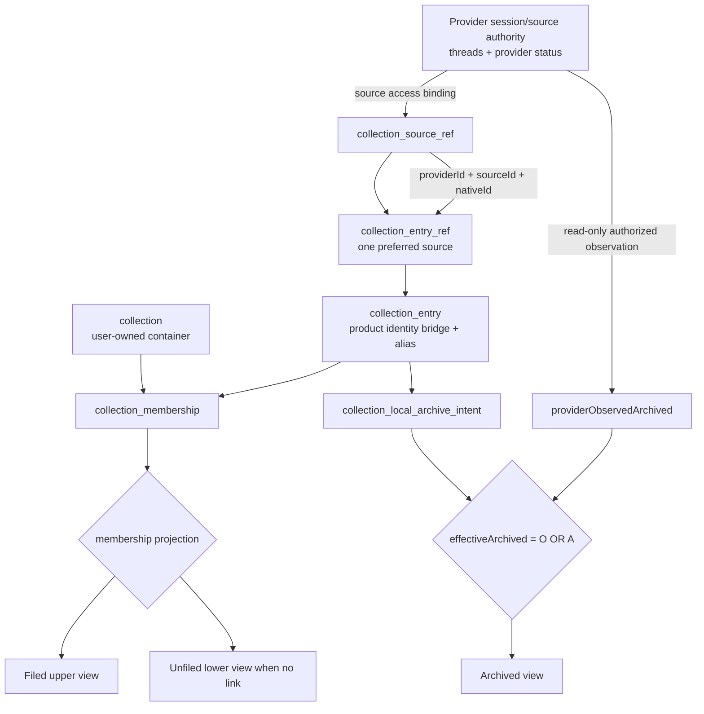
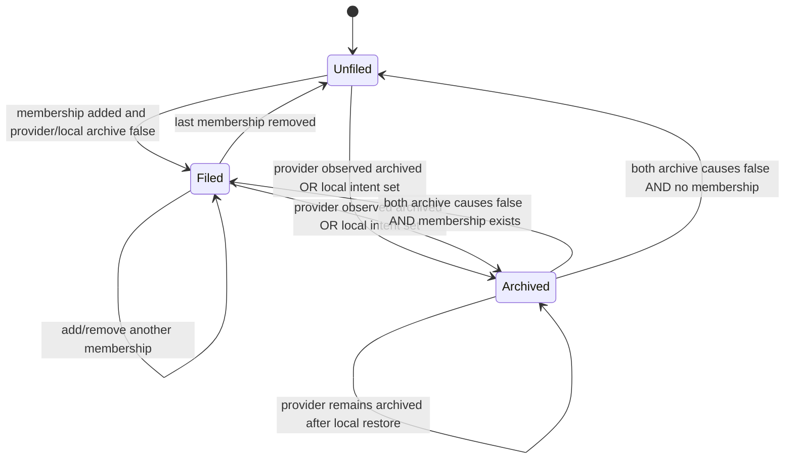
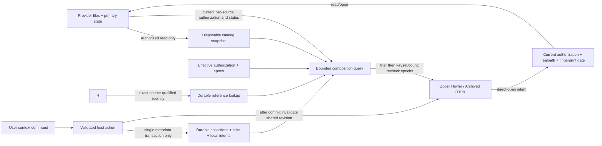
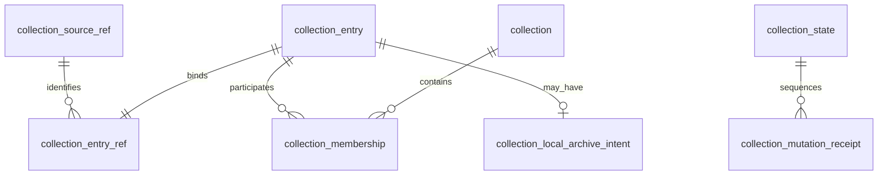

## Current implementation boundary (2026-11-06)

The original domain proposal below is retained. Its shared state tree and
membership-driven lower filtering are superseded by the independent domains in
[the overview](navigator-collections.md#current-implementation-boundary-2026-11-06)
and [ADR-064](../decisions/064-independent-collections-board.md). Current upper
CRUD/links affect only collection metadata. Lower Agent Sessions never consumes
membership. [ADR-073](../decisions/073-collections-entry-metadata.md) accepts
entry aliases, session-local archive intent and explicit rebind within this
independent upper board; the proposed projection DAG remains deferred.

## 0. Entity DAG, data flow, and state model

The provider session/source remains the authoritative content node. Product
metadata is a bridge and association graph around that node; it never becomes a
second transcript store. A source/root reference is a terminal grouping hint,
not a parent edge that files future children.



```mermaid
sequenceDiagram
  participant User
  participant Action as Native/Webview action
  participant Host as Host auth + provider readback
  participant Store as Collections store
  participant Views as Upper/lower projections
  User->>Action: context command (fileInto/unfile/move/alias/archive)
  Action->>Host: bounded request + expectedRevision
  Host->>Host: authorize selected source; verify identity and provider status
  Host->>Host: resolve exact provider/source/native identity; no access grant
  Host->>Store: BEGIN IMMEDIATE; CAS; mutate owned rows
  Store-->>Host: commit metadataRevision + receipt
  Host->>Views: invalidate once with shared revision
  Views->>Host: read upper/lower/archived with bound cursor
  Host-->>User: one coherent state or fixed error
```



### Data flow boundaries



The graph is a relationship DAG, not a promise of arbitrary nested folders or
a scheduling engine. Provider parent/child session edges remain provider-owned;
collection links are many-to-many associations to exact leaves.

### Durable identity and ownership

The proposed durable aggregate lives in a separate product-owned
`session-navigator/collections.sqlite` under the extension's existing profile
storage boundary. Its schema version starts at **1**, separately from catalog
schema 3, catalog snapshot version 1, and transport protocol versions. It uses
the existing TypeScript SQLite infrastructure owner and adds no runtime engine.
Catalog rebuild/reset must preserve this database. Authorization and source
settings remain authoritative in their current owner, not in these tables.

Storage choice is proposed, not dictated by the existing schema. Adding owned
tables to the existing catalog without disposable-source foreign keys would
provide natural joins and one SQLite read snapshot, but existing catalog-file
replacement/reset would need a new preservation guarantee. A separate metadata
file makes that lifetime explicit and survives replacement of the derived
catalog. Its cost is read coordination: **WAL does not provide an atomic
cross-database snapshot or commit**. A host-resolved read-only ATTACH/query is
only a short bounded join, not proof of simultaneous snapshots. Capture and
recheck catalog generation, metadata revision, authorization and provider-status
epochs around each projection; retry/discard if any changed. Writes stay in one
metadata database. Review this tradeoff before implementation.



`collection_id`, `entry_id`, and `source_ref_id` are host-generated opaque UUIDs.
Display edits never change them. A source reference records the existing
canonical `source_id` and provider identifier, never generation or fingerprint.
`collection_entry` is only a product-owned metadata anchor for the qualified
provider identity; the provider session remains the content/status authority.
The entry contains no transcript, source bytes, provider payload, or copied
catalog record.
For session references, `native_id` is the existing provider-owned logical ID.
For an explicitly registered file used as a whole attachment, the source ID
identifies that exact file registration and native ID is reserved `@file`.
For a source/root/folder reference it is `@source`. These reserved keys exist
only inside this aggregate and do not redefine vendor entity IDs.

The v1 durable identity is the exact tuple `(providerId, sourceId, nativeId)`.
`identity_quality` is `provider-stable` only when the adapter can substantiate
the native ID; filename/relative-row fallback IDs and ordinary file
registrations are `location-bound`. Root/state-root relocation changes the
registered source identity and therefore resolves as a distinct reference until
the user explicitly rebinds an existing entry. Never merge by title, mtime,
filename similarity, content fingerprint, or native ID across sources. The
current catalog keys entities by source, generation, and native ID; generation
identifies a catalog snapshot, not a cross-source identity authority.

Every source remains independently authorized and owns its provider status.
Matching native IDs in two source registrations do not establish that the roots
are equivalent, that they refer to the same underlying state, or that one
registration may reuse another's metadata. Collection membership, aliases, and
local archive intent remain attached to the exact source-qualified entry.
Unknown or stale status under an authorized source produces pending coverage;
revoked sources remain redacted and cannot be substituted by another source.
Partial discovery never proves that a reference is missing or active.

Cross-root deduplication is outside the v1 contract. A future optional
provider-owned contract may be evaluated only if the provider supplies a
reproducible, authorization-bound identity proof and tests covering equivalent
roots, authority changes, state-database replacement, revoke/reauthorize,
replacement, and native-ID reuse. Such a contract must separately prove that
identity equality never transfers authorization and define conflict behavior
for aliases, memberships, local archive intent, and provider status. Until then,
no authority hash, authority-key index, cross-root lookup, or cross-root status
aggregation is part of the schema or runtime proposal.

Only the host resolves raw URIs, native IDs, and locations. They stay internal
to infrastructure and are never list DTOs or continuation tokens. Local files
(including Markdown) require explicit file authorization/registration; an
unsupported parser never causes provider-home discovery or content copying.
Source references are immutable identity rows. Rebind changes the entry's
current reference to a separately authorized target and preserves its entry ID,
alias, and memberships. There is one current reference per entry, not a list of
fallback paths that could silently open the wrong file.
If the preferred source is revoked, another source registration is not an
implicit fallback, even when its native ID matches. It must be independently
authorized and explicitly selected through the existing recovery/rebind flow.
Without current authorization for the exact reference, retain a redacted/pending
placeholder. Explicit rebind may update the preferred binding in place only
after target authorization and collision checks; it preserves links/alias/intent
atomically and never merges with another entry.
Native archive status can be observed through authorized state metadata while
the relocated rollout fails a selected `sessions` subroot's file-containment
gate. Observable archive status is not permission to open that file: keep an
Archived/pending redacted placeholder and offer the existing explicit source
authorization flow. Never widen a root or skip realpath/probe checks to recover
an archived rollout.
